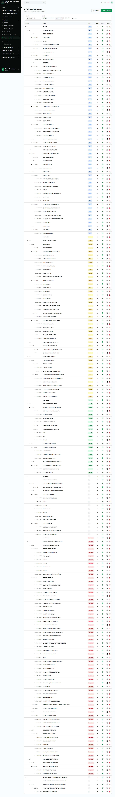

# Plano de Contas

- **Módulo:** FINANCEIRO
- **Tela:** Plano de Contas
- **URL:** `/plano-contas`
- **Título na página:** Plano de Contas

## Objetivo (inferido)

Tela "Plano de Contas" do módulo FINANCEIRO. Apresenta listagem em tabela com colunas Código, Nome, Tipo, Nível, Ativo, Ações. Possui 2 campo(s) de entrada/filtro. Texto de apoio: "Plano de Contas Estrutura hierárquica de contas contábeis Imprimir Nova Conta Buscar Tipo Todos Expandir Tudo Recolher 212 contas Código Nome Tipo Nível Ativo Ações 1 ATIVO Ativo 1 1.1 ATIVO CIRCULANT…"

## Screenshot

## Campos

| Nome | Rótulo | Tipo | Obrigatório | Valores/opções |
|---|---|---|---|---|
| — | Buscar | text | não indicado | — |
| — | Tipo | combobox | não indicado | — |

## Botões e ações

- Buscar... ⌘K
- Toggle theme
- Customize theme
- Notifications
- GC
- Imprimir
- Nova Conta
- Todos
- Expandir Tudo
- Recolher
- (ícone sem rótulo)

## Tabelas / grids

**Tabela 1** — 212 linha(s) visível(is)

- Colunas: Código · Nome · Tipo · Nível · Ativo · Ações
- Colunas possivelmente ordenáveis: não identificado

- Filtros/busca: Buscar, Tipo
- Paginação: não identificada

## Abas

_Nenhuma aba._

## Modais

_Nenhum modal aberto na carga da tela. Modais disparados por botões não foram abertos (regra somente-leitura)._

## Links para outras telas

_Nenhum link na área principal._

## Mensagens e validações visíveis

_Nenhuma mensagem visível._
