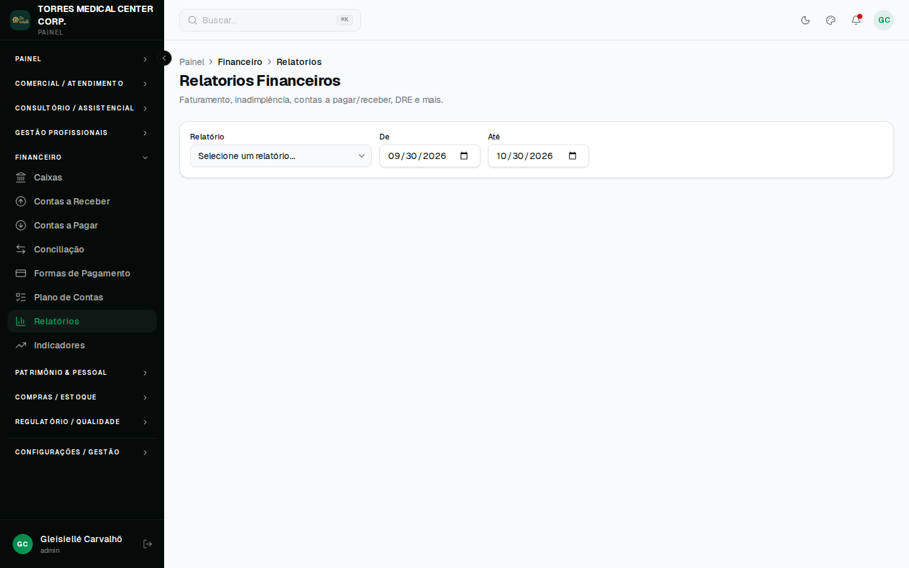

# Relatórios

- **Módulo:** FINANCEIRO
- **Tela:** Relatórios
- **URL:** `/financeiro/relatorios`
- **Título na página:** Relatorios Financeiros

## Objetivo (inferido)

Tela "Relatórios" do módulo FINANCEIRO. Possui 3 campo(s) de entrada/filtro. Texto de apoio: "Painel Financeiro Relatorios Relatorios Financeiros Faturamento, inadimplência, contas a pagar/receber, DRE e mais. Relatório Selecione um relatório... FIN-01 — Inadimplencia FIN-02 — Pagamentos em An…"

## Screenshot

## Campos

| Nome | Rótulo | Tipo | Obrigatório | Valores/opções |
|---|---|---|---|---|
| — | — | select | não indicado | Selecione um relatório..., FIN-01 — Inadimplencia, FIN-02 — Pagamentos em Andamento, FIN-03 — Pagamentos Nao Realizados, FIN-04 — Pro Bono / Permuta, FIN-05 — DRE por Unidade, FIN-06 — Faturamento por Período, FIN-07 — Faturamento por Tipo de Pagamento, FIN-08 — Faturamento por Profissional, FIN-09 — Faturamento por Procedimento, FIN-10 — Faturamento por Paciente, FIN-11 — Contas a Receber e Pagar por Vencimento, FIN-12 — Despesa por Centro de Custo, FIN-13 — Extrato por Plano de Contas (Despesas), FIN-14 — Extrato por Plano de Contas (Receitas), FIN-15 — Conciliação Bancária, FIN-16 — Conciliação de Cartão, FIN-17 — Extrato por Fornecedor / Contrato, FIN-18 — Extrato de Créditos do Paciente, FIN-19 — Contas a Pagar (Detalhado), FIN-20 — Contas a Receber (Detalhado), FIN-21 — Mix de Produtos Coworking |
| — | De | date | não indicado | — |
| — | Até | date | não indicado | — |

## Botões e ações

- Buscar... ⌘K
- Toggle theme
- Customize theme
- Notifications
- GC

## Tabelas / grids

_Nenhuma tabela encontrada._

- Filtros/busca: não identificado
- Paginação: não identificada

## Abas

_Nenhuma aba._

## Modais

_Nenhum modal aberto na carga da tela. Modais disparados por botões não foram abertos (regra somente-leitura)._

## Links para outras telas

- Painel → `/`

## Mensagens e validações visíveis

_Nenhuma mensagem visível._
