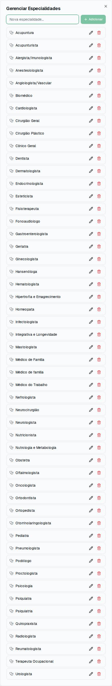
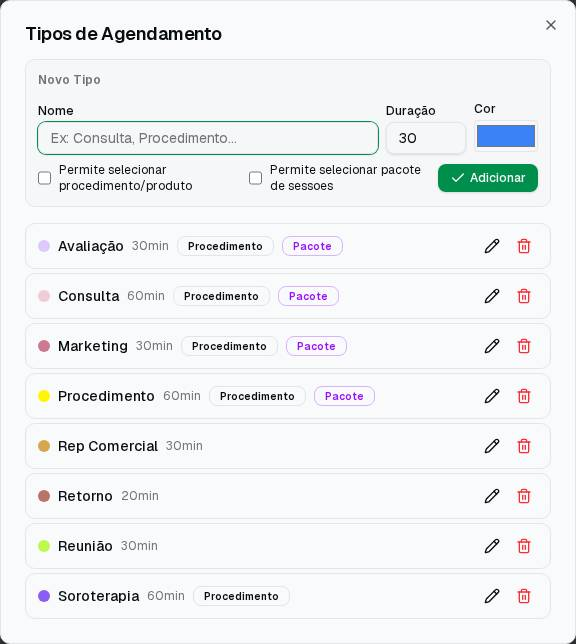
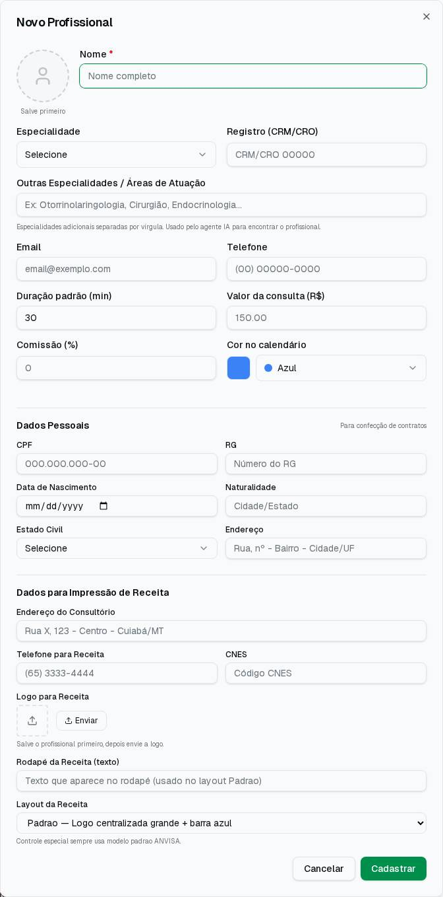
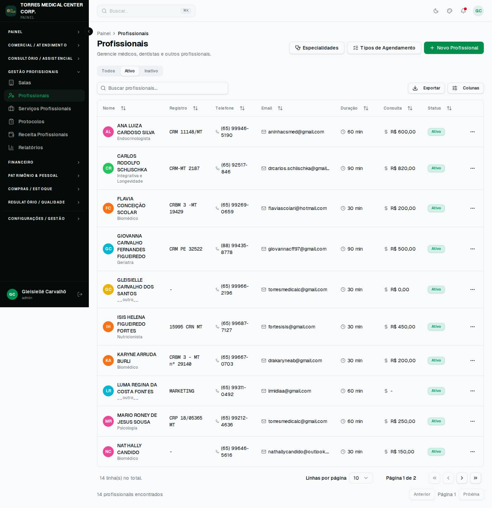
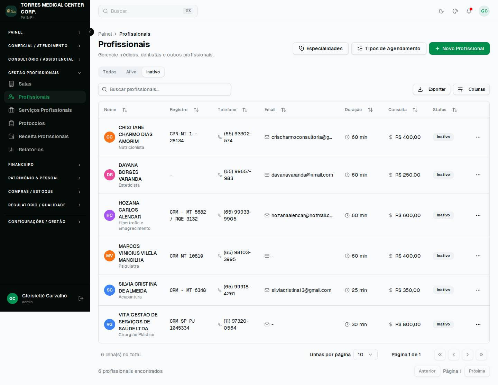
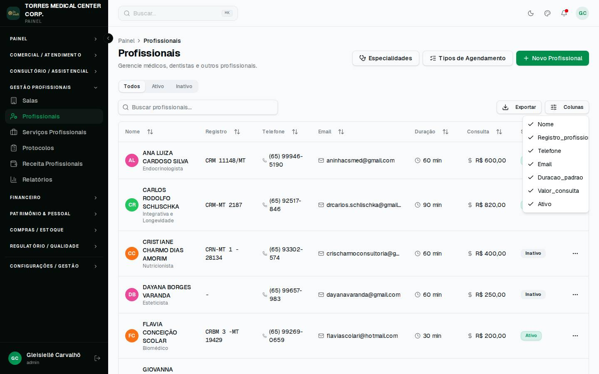
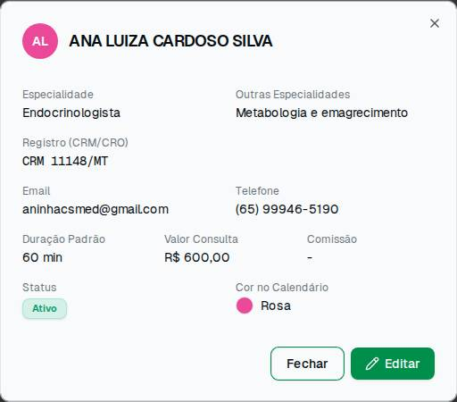
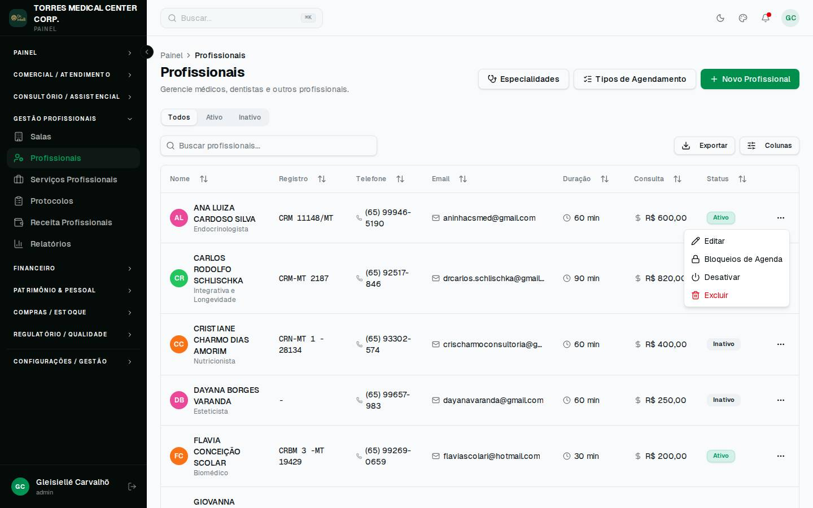
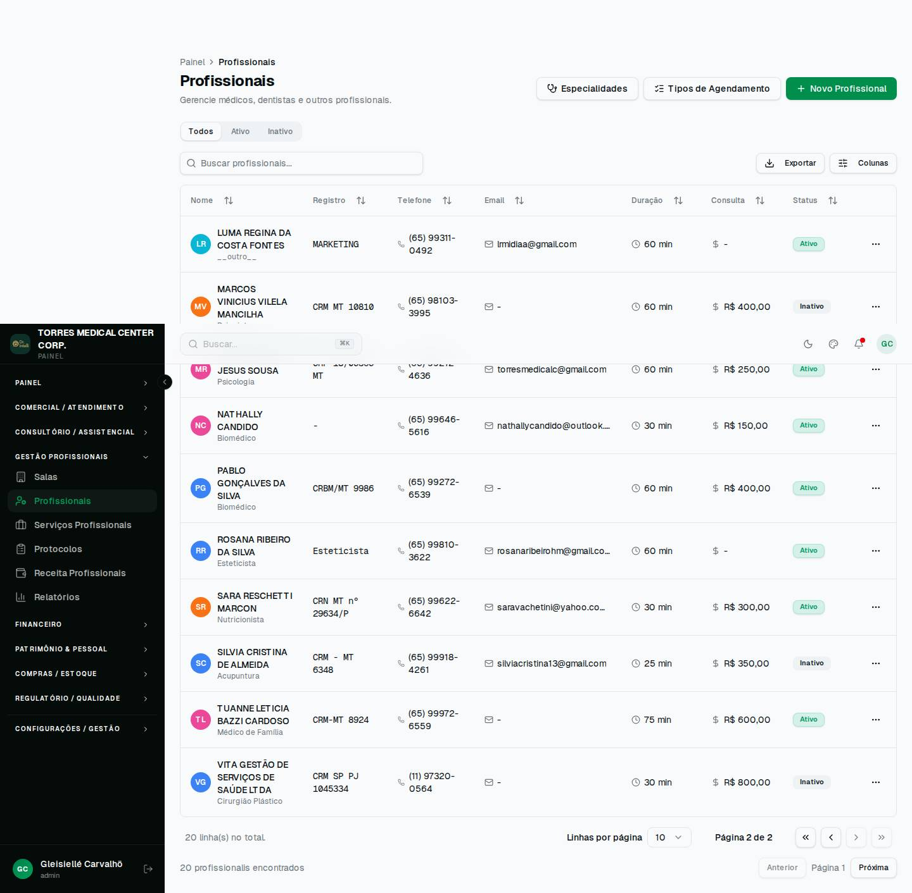

# Profissionais

- **Módulo:** GESTÃO PROFISSIONAIS
- **Tela:** Profissionais
- **URL:** `/profissionais`
- **Título na página:** Profissionais

## Objetivo (inferido)

Tela "Profissionais" do módulo GESTÃO PROFISSIONAIS. Apresenta listagem em tabela com colunas Nome, Registro, Telefone, Email, Duração, Consulta. Possui 2 campo(s) de entrada/filtro. Texto de apoio: "Painel Profissionais Profissionais Gerencie médicos, dentistas e outros profissionais. Especialidades Tipos de Agendamento Novo Profissional Todos Ativo Inativo Exportar Colunas Nome Registro Telefone…"

## Screenshot

## Campos

| Nome | Rótulo | Tipo | Obrigatório | Valores/opções |
|---|---|---|---|---|
| — | Buscar profissionais... | text | não indicado | — |
| — | — | combobox | não indicado | — |

## Botões e ações

- Buscar... ⌘K
- Toggle theme
- Customize theme
- Notifications
- GC
- Especialidades
- Tipos de Agendamento
- Novo Profissional
- Todos
- Ativo
- Inativo
- Exportar
- Colunas
- Nome
- Registro
- Telefone
- Email
- Duração
- Consulta
- Status
- Ações
- 10
- Ir para primeira página _(desabilitado)_
- Ir para página anterior _(desabilitado)_
- Ir para próxima página
- Ir para última página
- Anterior _(desabilitado)_
- Próxima

## Tabelas / grids

**Tabela 1** — 10 linha(s) visível(is)

- Colunas: Nome · Registro · Telefone · Email · Duração · Consulta · Status
- Colunas possivelmente ordenáveis: Nome, Registro, Telefone, Email, Duração, Consulta, Status

- Filtros/busca: Buscar profissionais...
- Paginação: Página 1 de 2

## Abas

_Nenhuma aba._

## Modais

_Nenhum modal aberto na carga da tela. Modais disparados por botões não foram abertos (regra somente-leitura)._

## Links para outras telas

- Painel → `/`

## Mensagens e validações visíveis

_Nenhuma mensagem visível._

<!-- estados -->
## Estados capturados (interações de visualização)

_Capturados em 15/10/2026 clicando só em itens de visualização do checklist da issue. Nenhum formulário foi preenchido e toda gravação foi bloqueada._

### Especialidades

- Abre modal **Gerenciar Especialidades**

| Campo | Tipo | Obrigatório | Opções |
|---|---|---|---|
| Nova especialidade... | text | não indicado | — |

- Botões do modal: Adicionar · Close

### Tipos de Agendamento

- Abre modal **Tipos de Agendamento**

| Campo | Tipo | Obrigatório | Opções |
|---|---|---|---|
| Nome | text | não indicado | — |
| Duração | number | não indicado | — |
| Cor | color | não indicado | — |
| Permite selecionar procedimento/produto | checkbox | não indicado | — |
| Permite selecionar pacote de sessoes | checkbox | não indicado | — |

- Botões do modal: Adicionar · Close

### Novo Profissional

- Abre modal **Novo Profissional**

| Campo | Tipo | Obrigatório | Opções |
|---|---|---|---|
| Nome * | text | sim | — |
| Especialidade | combobox | não indicado | — |
| Registro (CRM/CRO) | text | não indicado | — |
| Outras Especialidades / Áreas de Atuação | text | não indicado | — |
| Email | email | não indicado | — |
| Telefone | text | não indicado | — |
| Duração padrão (min) | number | não indicado | — |
| Valor da consulta (R$) | number | não indicado | — |
| Comissão (%) | number | não indicado | — |
| Cor no calendário | combobox | não indicado | — |
| CPF | text | não indicado | — |
| RG | text | não indicado | — |
| Data de Nascimento | date | não indicado | — |
| Naturalidade | text | não indicado | — |
| Estado Civil | combobox | não indicado | — |
| Endereço | text | não indicado | — |
| Endereço do Consultório | text | não indicado | — |
| Telefone para Receita | text | não indicado | — |
| CNES | text | não indicado | — |
| Enviar | file | não indicado | — |
| Rodapé da Receita (texto) | text | não indicado | — |
| Layout da Receita | select | não indicado | Padrao — Logo centralizada grande + barra azul, Compacto — Logo pequena esquerda + nome/CRM direita, Timbrado — Sem logo, nome/CRM centralizado, Personalizado — Upload de cabecalho e rodape |

- Botões do modal: Selecione · Azul · Cancelar · Cadastrar · Close

### Todos

### Ativo

### Inativo

### Colunas

- Itens do menu/lista: Nome · Registro_profissional · Telefone · Email · Duracao_padrao · Valor_consulta · Ativo

### Ordenação por coluna — 1 print de exemplo (colunas: Nome, Registro, Telefone, Email, Duração, Consulta, Status)

### Clicar na linha da tabela (abre detalhe)

- Abre modal
- Botões do modal: Fechar · Editar · Close

### Ações (na linha da tabela)

- Itens do menu/lista: Editar · Bloqueios de Agenda · Desativar · Excluir

### Paginação — 1 print da página 2

<!-- /estados -->
