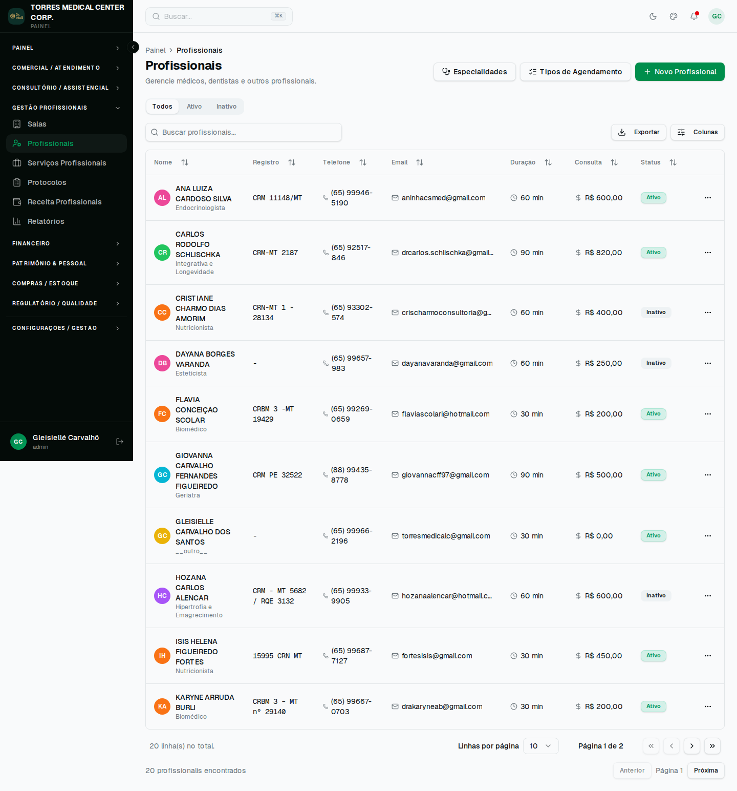

# Profissionais

- **Módulo:** GESTÃO PROFISSIONAIS
- **Tela:** Profissionais
- **URL:** `/profissionais`
- **Título na página:** Profissionais

## Objetivo (inferido)

Tela "Profissionais" do módulo GESTÃO PROFISSIONAIS. Apresenta listagem em tabela com colunas Nome, Registro, Telefone, Email, Duração, Consulta. Possui 2 campo(s) de entrada/filtro. Texto de apoio: "Painel Profissionais Profissionais Gerencie médicos, dentistas e outros profissionais. Especialidades Tipos de Agendamento Novo Profissional Todos Ativo Inativo Exportar Colunas Nome Registro Telefone…"

## Screenshot

## Campos

| Nome | Rótulo | Tipo | Obrigatório | Valores/opções |
|---|---|---|---|---|
| — | Buscar profissionais... | text | não indicado | — |
| — | — | combobox | não indicado | — |

## Botões e ações

- Buscar... ⌘K
- Toggle theme
- Customize theme
- Notifications
- GC
- Especialidades
- Tipos de Agendamento
- Novo Profissional
- Todos
- Ativo
- Inativo
- Exportar
- Colunas
- Nome
- Registro
- Telefone
- Email
- Duração
- Consulta
- Status
- Ações
- 10
- Ir para primeira página _(desabilitado)_
- Ir para página anterior _(desabilitado)_
- Ir para próxima página
- Ir para última página
- Anterior _(desabilitado)_
- Próxima

## Tabelas / grids

**Tabela 1** — 10 linha(s) visível(is)

- Colunas: Nome · Registro · Telefone · Email · Duração · Consulta · Status
- Colunas possivelmente ordenáveis: Nome, Registro, Telefone, Email, Duração, Consulta, Status

- Filtros/busca: Buscar profissionais...
- Paginação: Página 1 de 2

## Abas

_Nenhuma aba._

## Modais

_Nenhum modal aberto na carga da tela. Modais disparados por botões não foram abertos (regra somente-leitura)._

## Links para outras telas

- Painel → `/`

## Mensagens e validações visíveis

_Nenhuma mensagem visível._
