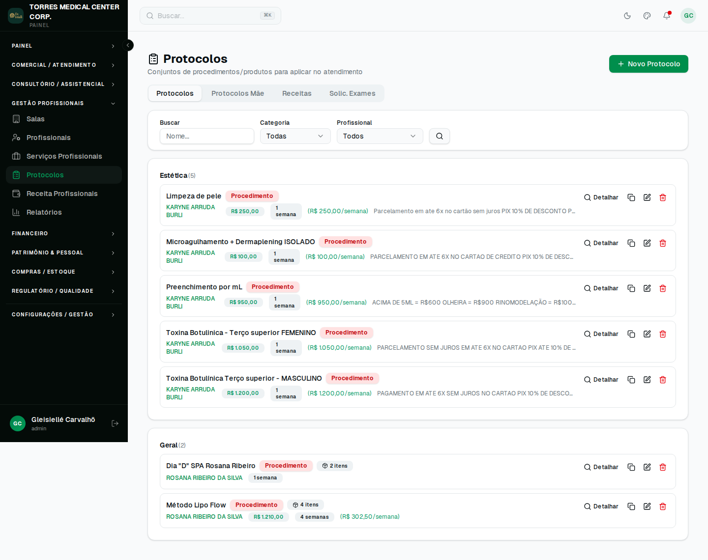
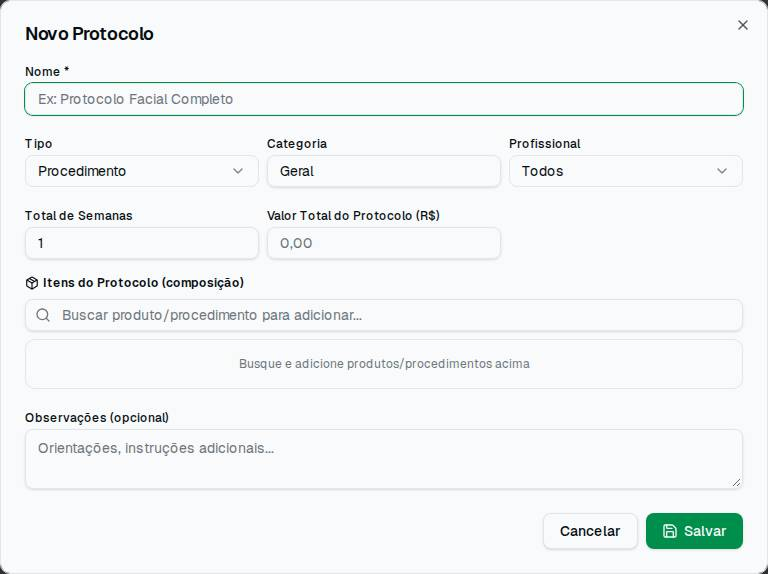
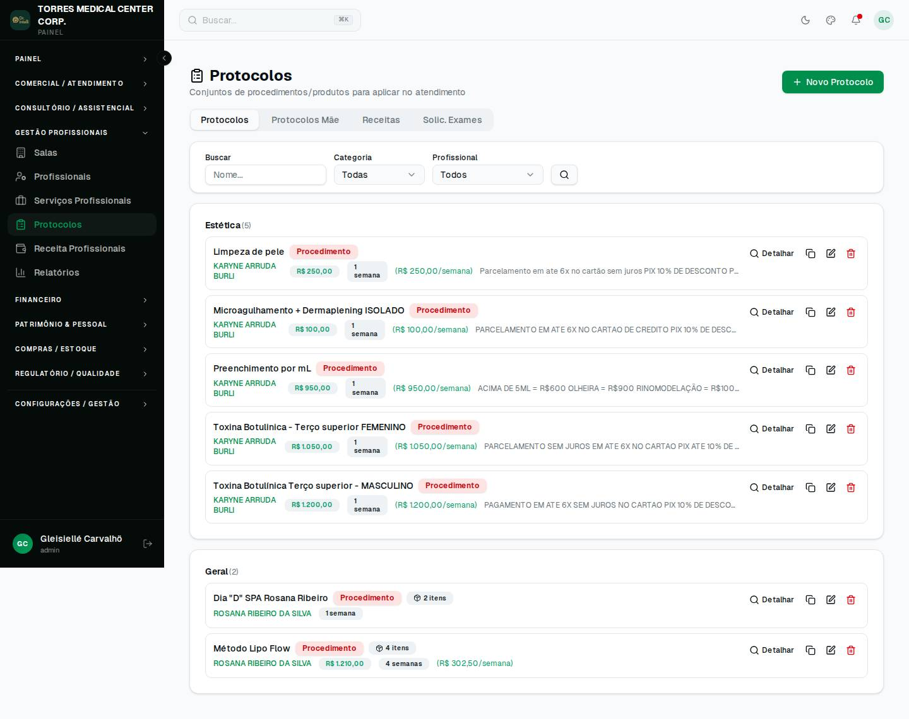
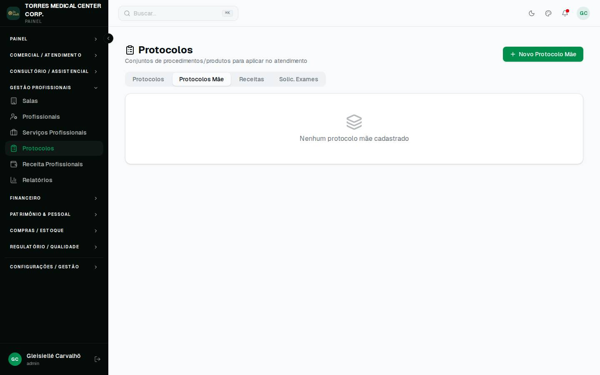
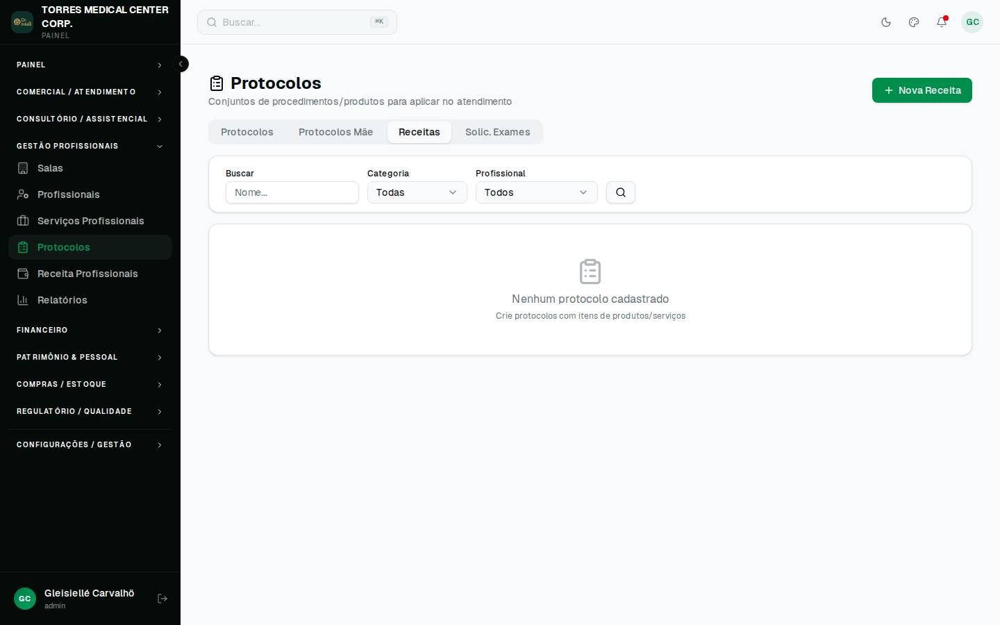
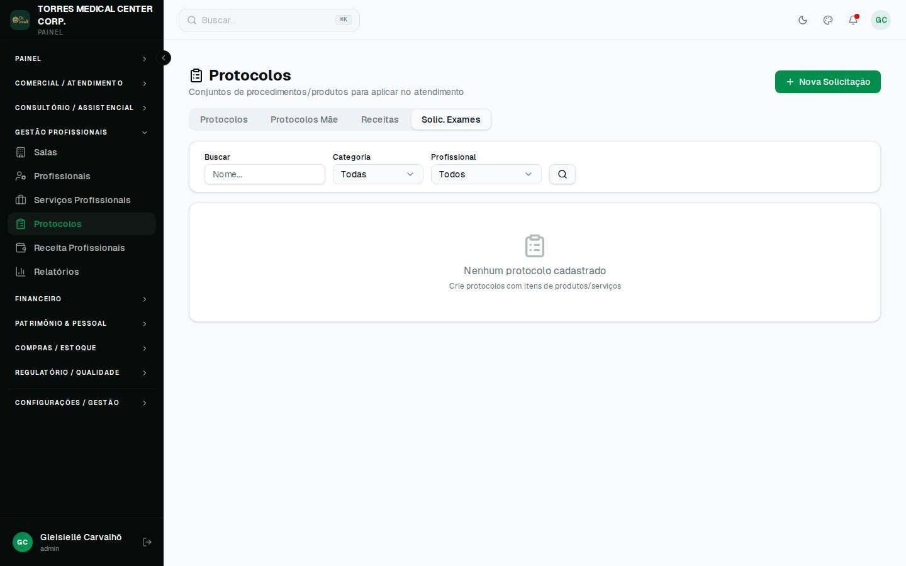
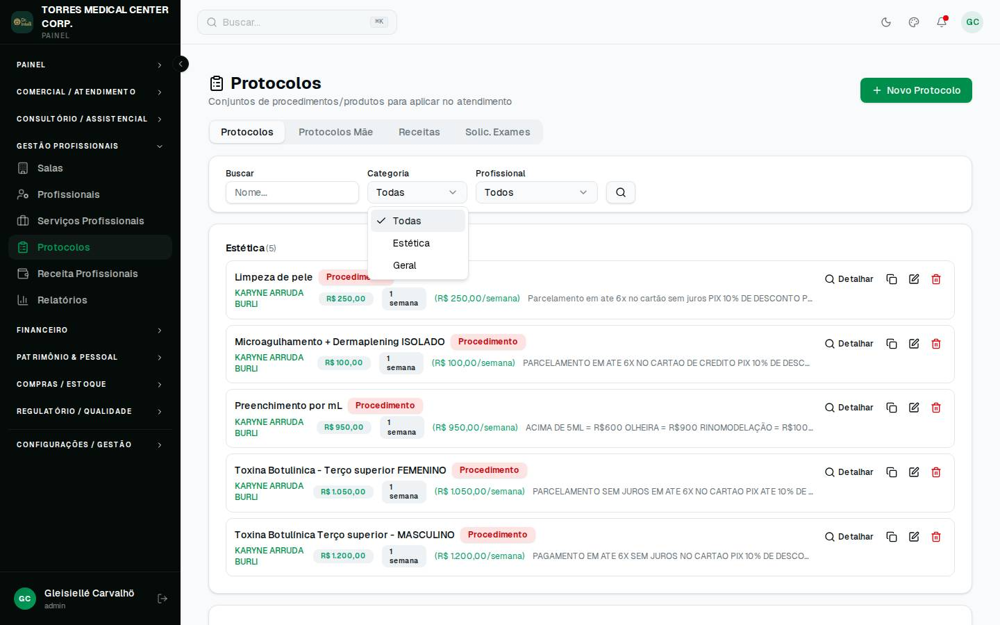
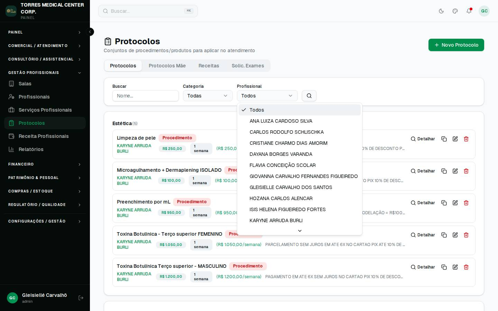
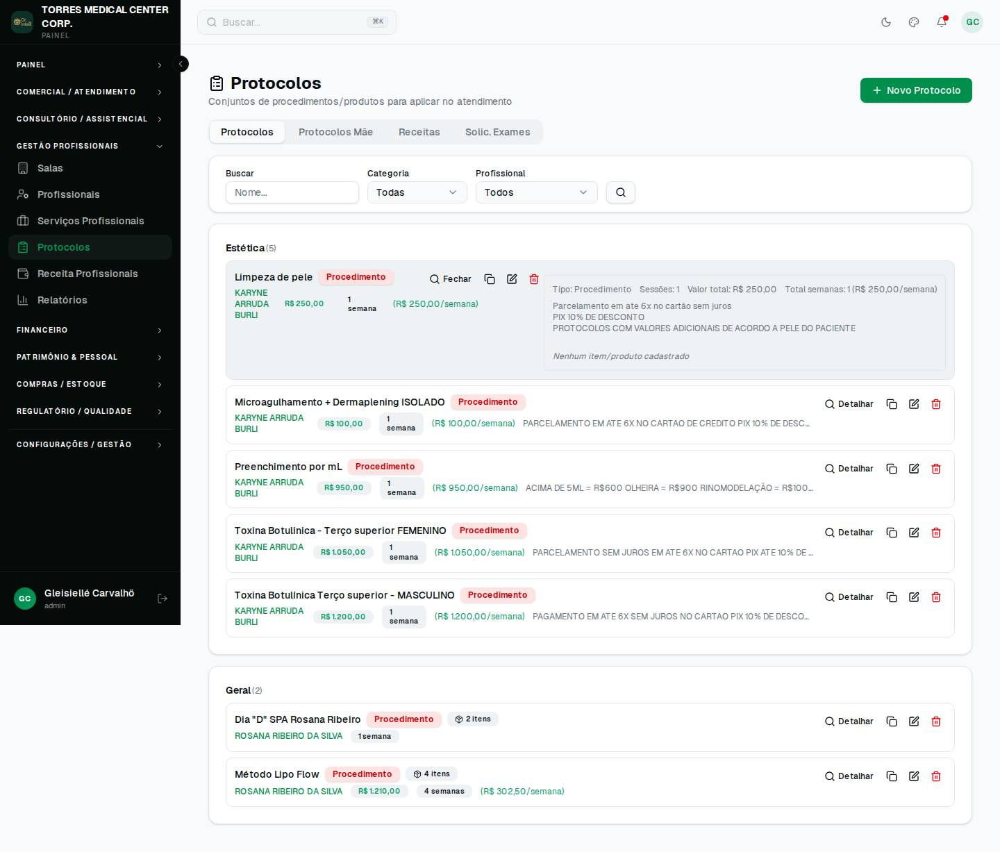
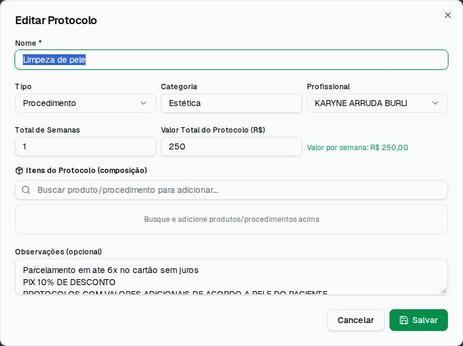

# Protocolos

- **Módulo:** GESTÃO PROFISSIONAIS
- **Tela:** Protocolos
- **URL:** `/protocolos`
- **Título na página:** Protocolos

## Objetivo (inferido)

Tela "Protocolos" do módulo GESTÃO PROFISSIONAIS. Possui 3 campo(s) de entrada/filtro. Texto de apoio: "Protocolos Conjuntos de procedimentos/produtos para aplicar no atendimento Novo Protocolo Protocolos Protocolos Mãe Receitas Solic. Exames Buscar Categoria Todas Profissional Todos Estética (5) Limpez…"

## Screenshot

## Campos

| Nome | Rótulo | Tipo | Obrigatório | Valores/opções |
|---|---|---|---|---|
| — | Buscar | text | não indicado | — |
| — | Categoria | combobox | não indicado | — |
| — | Profissional | combobox | não indicado | — |

## Botões e ações

- Buscar... ⌘K
- Toggle theme
- Customize theme
- Notifications
- GC
- Novo Protocolo
- Protocolos
- Protocolos Mãe
- Receitas
- Solic. Exames
- Todas
- Todos
- (ícone sem rótulo)
- Detalhar
- Duplicar

## Tabelas / grids

_Nenhuma tabela encontrada._

- Filtros/busca: não identificado
- Paginação: não identificada

## Abas

_Nenhuma aba._

## Modais

_Nenhum modal aberto na carga da tela. Modais disparados por botões não foram abertos (regra somente-leitura)._

## Links para outras telas

_Nenhum link na área principal._

## Mensagens e validações visíveis

_Nenhuma mensagem visível._

<!-- estados -->
## Estados capturados (interações de visualização)

_Capturados em 15/10/2026 clicando só em itens de visualização do checklist da issue. Nenhum formulário foi preenchido e toda gravação foi bloqueada._

### Novo Protocolo

- Abre modal **Novo Protocolo**

| Campo | Tipo | Obrigatório | Opções |
|---|---|---|---|
| Nome * | text | sim | — |
| Tipo | combobox | não indicado | — |
| Categoria | text | não indicado | — |
| Profissional | combobox | não indicado | — |
| Total de Semanas | number | não indicado | — |
| Valor Total do Protocolo (R$) | number | não indicado | — |
| Buscar produto/procedimento para adicionar... | text | não indicado | — |
| Observações (opcional) | textarea | não indicado | — |

- Botões do modal: Procedimento · Todos · Cancelar · Salvar · Close

### Protocolos

### Protocolos Mãe

### Receitas

### Solic. Exames

### Dropdown aberto: Todas

- Itens do menu/lista: Todas · Estética · Geral

### Dropdown aberto: Todos

- Itens do menu/lista: Todos · ANA LUIZA CARDOSO SILVA · CARLOS RODOLFO SCHLISCHKA · CRISTIANE CHARMO DIAS AMORIM · DAYANA BORGES VARANDA · FLAVIA CONCEIÇÃO SCOLAR · GIOVANNA CARVALHO FERNANDES FIGUEIREDO · GLEISIELLE CARVALHO DOS SANTOS · HOZANA CARLOS ALENCAR · ISIS HELENA FIGUEIREDO FORTES · KARYNE ARRUDA BURLI · LUMA REGINA DA COSTA FONTES · MARCOS VINICIUS VILELA MANCILHA · MARIO RONEY DE JESUS SOUSA · NATHALLY CANDIDO · PABLO GONÇALVES DA SILVA · ROSANA RIBEIRO DA SILVA · SARA RESCHETTI MARCON · SILVIA CRISTINA DE ALMEIDA · TUANNE LETICIA BAZZI CARDOSO · VITA GESTÃO DE SERVIÇOS DE SAÚDE LTDA

### Buscar (ícone lupa)

### Detalhar

### Editar (ícone lápis)

- Abre modal **Editar Protocolo**

| Campo | Tipo | Obrigatório | Opções |
|---|---|---|---|
| Nome * | text | sim | — |
| Tipo | combobox | não indicado | — |
| Categoria | text | não indicado | — |
| Profissional | combobox | não indicado | — |
| Total de Semanas | number | não indicado | — |
| Valor Total do Protocolo (R$) | number | não indicado | — |
| Buscar produto/procedimento para adicionar... | text | não indicado | — |
| Observações (opcional) | textarea | não indicado | — |

- Botões do modal: Procedimento · KARYNE ARRUDA BURLI · Cancelar · Salvar · Close

<!-- /estados -->
