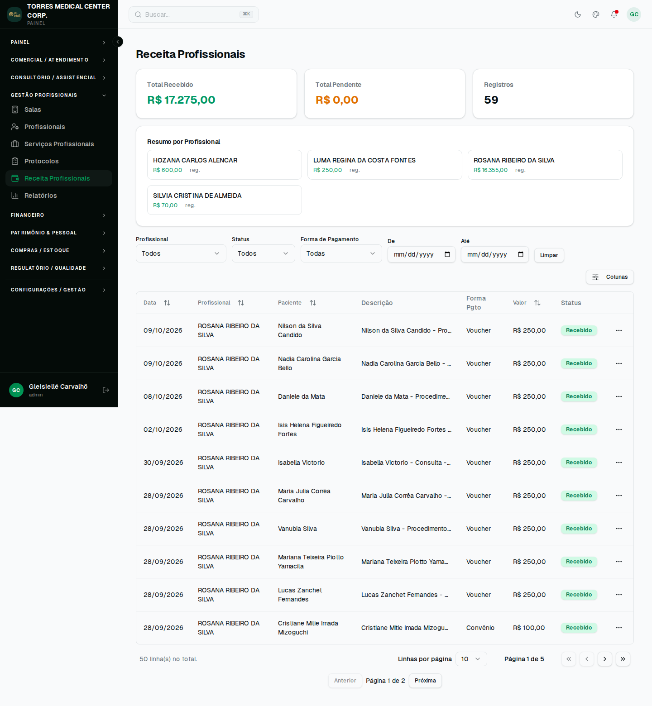

# Receita Profissionais

- **Módulo:** GESTÃO PROFISSIONAIS
- **Tela:** Receita Profissionais
- **URL:** `/receita-profissionais`
- **Título na página:** Receita Profissionais

## Objetivo (inferido)

Tela "Receita Profissionais" do módulo GESTÃO PROFISSIONAIS. Apresenta listagem em tabela com colunas Data, Profissional, Paciente, Descrição, Forma Pgto, Valor. Possui 6 campo(s) de entrada/filtro. Texto de apoio: "Receita Profissionais Total Recebido R$ 17.275,00 Total Pendente R$ 0,00 Registros 59 Resumo por Profissional HOZANA CARLOS ALENCAR R$ 600,00 reg. LUMA REGINA DA COSTA FONTES R$ 250,00 reg. ROSANA RIB…"

## Screenshot

## Campos

| Nome | Rótulo | Tipo | Obrigatório | Valores/opções |
|---|---|---|---|---|
| — | Profissional | combobox | não indicado | — |
| — | Status | combobox | não indicado | — |
| — | Forma de Pagamento | combobox | não indicado | — |
| — | De | date | não indicado | — |
| — | Até | date | não indicado | — |
| — | — | combobox | não indicado | — |

## Botões e ações

- Buscar... ⌘K
- Toggle theme
- Customize theme
- Notifications
- GC
- Todos
- Todas
- Limpar
- Colunas
- Data
- Profissional
- Paciente
- Valor
- Ações
- 10
- Ir para primeira página _(desabilitado)_
- Ir para página anterior _(desabilitado)_
- Ir para próxima página
- Ir para última página
- Anterior _(desabilitado)_
- Próxima

## Tabelas / grids

**Tabela 1** — 10 linha(s) visível(is)

- Colunas: Data · Profissional · Paciente · Descrição · Forma Pgto · Valor · Status
- Colunas possivelmente ordenáveis: Data, Profissional, Paciente, Valor

- Filtros/busca: Profissional, Status, Forma de Pagamento, De, Até
- Paginação: 00

Registros

## Abas

_Nenhuma aba._

## Modais

_Nenhum modal aberto na carga da tela. Modais disparados por botões não foram abertos (regra somente-leitura)._

## Links para outras telas

_Nenhum link na área principal._

## Mensagens e validações visíveis

_Nenhuma mensagem visível._
