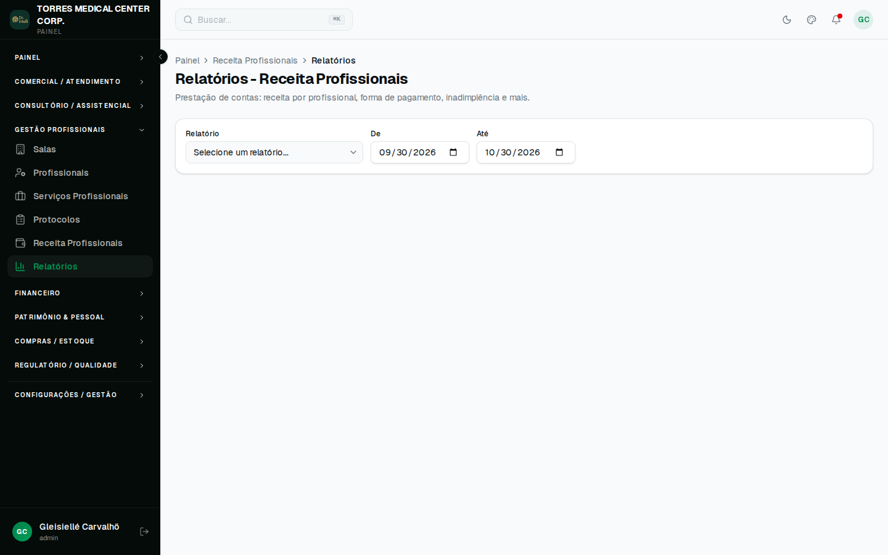

# Relatórios

- **Módulo:** GESTÃO PROFISSIONAIS
- **Tela:** Relatórios
- **URL:** `/receita-profissionais/relatorios`
- **Título na página:** Relatórios - Receita Profissionais

## Objetivo (inferido)

Tela "Relatórios" do módulo GESTÃO PROFISSIONAIS. Possui 3 campo(s) de entrada/filtro. Texto de apoio: "Painel Receita Profissionais Relatórios Relatórios - Receita Profissionais Prestação de contas: receita por profissional, forma de pagamento, inadimplência e mais. Relatório Selecione um relatório... …"

## Screenshot

## Campos

| Nome | Rótulo | Tipo | Obrigatório | Valores/opções |
|---|---|---|---|---|
| — | — | select | não indicado | Selecione um relatório..., RP-01 — Receita por Profissional, RP-02 — Detalhado (Recebidos + Pendentes), RP-03 — Por Forma de Pagamento, RP-04 — Pendentes (Parcelas + Sem Registro), RP-05 — Atendimentos por Profissional, RP-06 — Faturamento por Período, RP-07 — Receita por Paciente, RP-08 — Inadimplência, RP-09 — Contas por Faixa de Vencimento, RP-10 — Pagamentos em Andamento, RP-11 — Agendamentos sem Recebimento, RP-12 — Resumo Pendentes por Profissional, RP-13 — Consultas por Profissional e Forma de Pagamento |
| — | De | date | não indicado | — |
| — | Até | date | não indicado | — |

## Botões e ações

- Buscar... ⌘K
- Toggle theme
- Customize theme
- Notifications
- GC

## Tabelas / grids

_Nenhuma tabela encontrada._

- Filtros/busca: não identificado
- Paginação: não identificada

## Abas

_Nenhuma aba._

## Modais

_Nenhum modal aberto na carga da tela. Modais disparados por botões não foram abertos (regra somente-leitura)._

## Links para outras telas

- Painel → `/`
- Receita Profissionais → `/receita-profissionais`

## Mensagens e validações visíveis

_Nenhuma mensagem visível._
