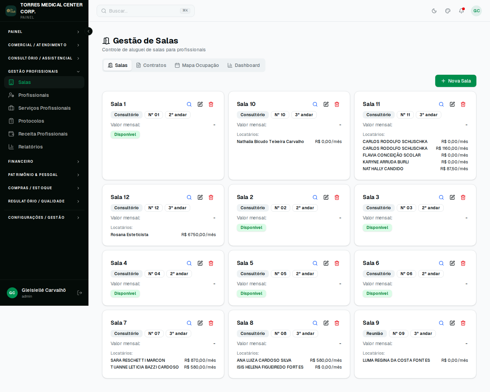
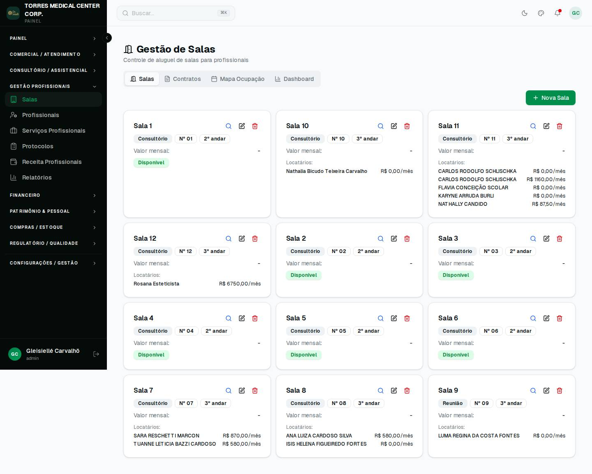
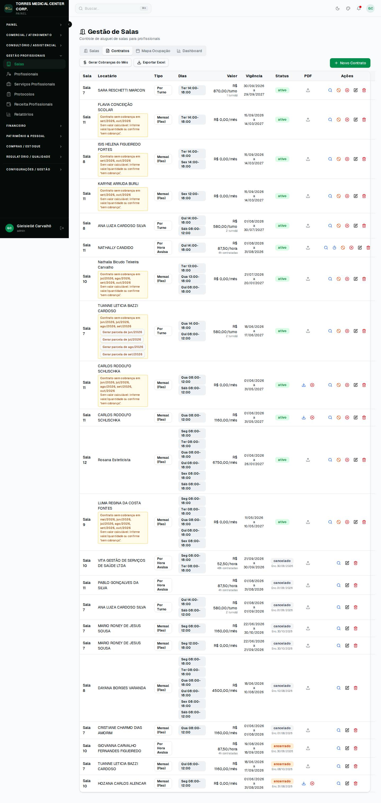
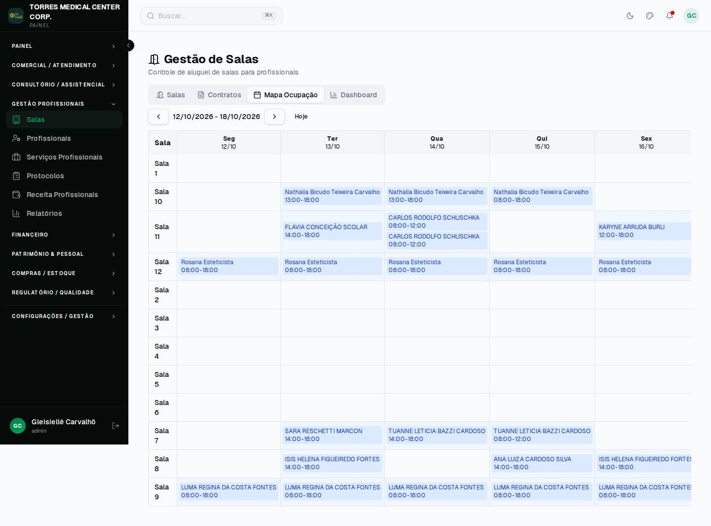
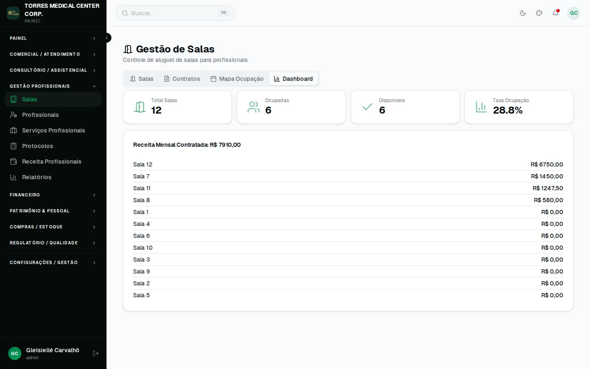
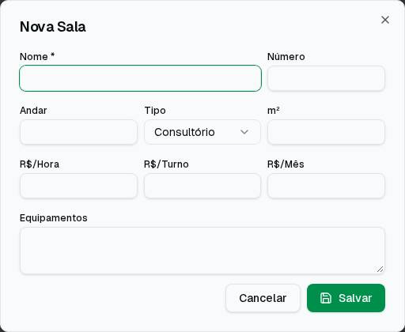
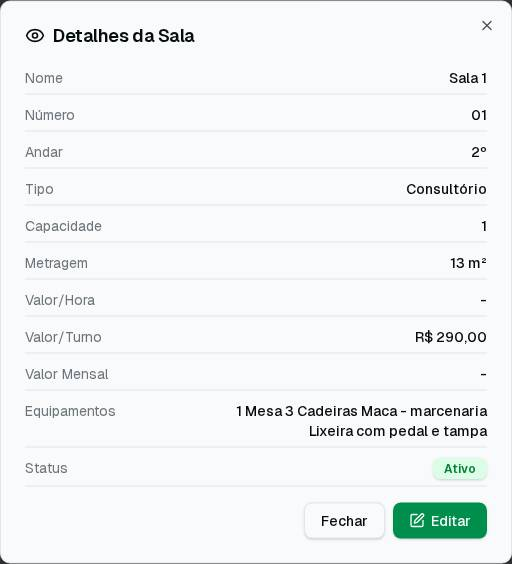
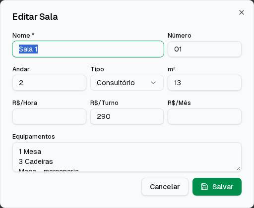

# Salas

- **Módulo:** GESTÃO PROFISSIONAIS
- **Tela:** Salas
- **URL:** `/salas`
- **Título na página:** Gestão de Salas

## Objetivo (inferido)

Tela "Salas" do módulo GESTÃO PROFISSIONAIS. Organizada em abas (Salas, Contratos, Mapa Ocupação, Dashboard). Texto de apoio: "Gestão de Salas Controle de aluguel de salas para profissionais Salas Contratos Mapa Ocupação Dashboard Nova Sala Sala 1 Consultório Nº 01 2º andar Valor mensal: - Disponível Sala 10 Consultório Nº 10…"

## Screenshot

## Campos

_Nenhum campo de formulário/filtro visível._

## Botões e ações

- Buscar... ⌘K
- Toggle theme
- Customize theme
- Notifications
- GC
- Salas
- Contratos
- Mapa Ocupação
- Dashboard
- Nova Sala
- Detalhar
- (ícone sem rótulo)

## Tabelas / grids

_Nenhuma tabela encontrada._

- Filtros/busca: não identificado
- Paginação: não identificada

## Abas

- Salas _(ativa)_
- Contratos
- Mapa Ocupação
- Dashboard

## Modais

_Nenhum modal aberto na carga da tela. Modais disparados por botões não foram abertos (regra somente-leitura)._

## Links para outras telas

_Nenhum link na área principal._

## Mensagens e validações visíveis

_Nenhuma mensagem visível._

<!-- estados -->
## Estados capturados (interações de visualização)

_Capturados em 15/10/2026 clicando só em itens de visualização do checklist da issue. Nenhum formulário foi preenchido e toda gravação foi bloqueada._

### Aba: Salas

### Aba: Contratos

### Aba: Mapa Ocupação

### Aba: Dashboard

### Nova Sala

- Abre modal **Nova Sala**

| Campo | Tipo | Obrigatório | Opções |
|---|---|---|---|
| Nome * | text | sim | — |
| Número | text | não indicado | — |
| Andar | text | não indicado | — |
| Tipo | combobox | não indicado | — |
| m² | number | não indicado | — |
| R$/Hora | number | não indicado | — |
| R$/Turno | number | não indicado | — |
| R$/Mês | number | não indicado | — |
| Equipamentos | textarea | não indicado | — |

- Botões do modal: Consultório · Cancelar · Salvar · Close

### Detalhar

- Abre modal **Detalhes da Sala**
- Botões do modal: Fechar · Editar · Close

### Editar (ícone lápis)

- Abre modal **Editar Sala**

| Campo | Tipo | Obrigatório | Opções |
|---|---|---|---|
| Nome * | text | sim | — |
| Número | text | não indicado | — |
| Andar | text | não indicado | — |
| Tipo | combobox | não indicado | — |
| m² | number | não indicado | — |
| R$/Hora | number | não indicado | — |
| R$/Turno | number | não indicado | — |
| R$/Mês | number | não indicado | — |
| Equipamentos | textarea | não indicado | — |

- Botões do modal: Consultório · Cancelar · Salvar · Close

<!-- /estados -->
