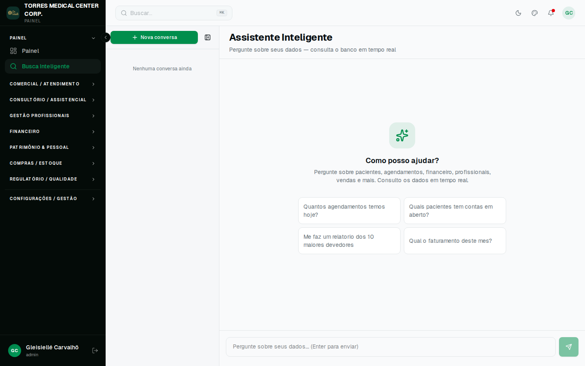

# Busca Inteligente

- **Módulo:** PAINEL
- **Tela:** Busca Inteligente
- **URL:** `/busca`
- **Título na página:** Assistente Inteligente

## Objetivo (inferido)

Tela "Busca Inteligente" do módulo PAINEL. Possui 1 campo(s) de entrada/filtro. Seções: Como posso ajudar?. Texto de apoio: "Nova conversa Nenhuma conversa ainda Assistente Inteligente Pergunte sobre seus dados — consulta o banco em tempo real Como posso ajudar? Pergunte sobre pacientes, agendamentos, financeiro, profission…"

## Screenshot

## Campos

| Nome | Rótulo | Tipo | Obrigatório | Valores/opções |
|---|---|---|---|---|
| — | Pergunte sobre seus dados... (Enter para enviar) | textarea | não indicado | — |

## Botões e ações

- Buscar... ⌘K
- Toggle theme
- Customize theme
- Notifications
- GC
- Nova conversa
- (ícone sem rótulo) _(desabilitado)_
- Quantos agendamentos temos hoje?
- Quais pacientes tem contas em aberto?
- Me faz um relatorio dos 10 maiores devedores
- Qual o faturamento deste mes?

## Tabelas / grids

_Nenhuma tabela encontrada._

- Filtros/busca: não identificado
- Paginação: não identificada

## Abas

_Nenhuma aba._

## Modais

_Nenhum modal aberto na carga da tela. Modais disparados por botões não foram abertos (regra somente-leitura)._

## Links para outras telas

_Nenhum link na área principal._

## Mensagens e validações visíveis

_Nenhuma mensagem visível._

## Seções (cabeçalhos)

- Como posso ajudar?
