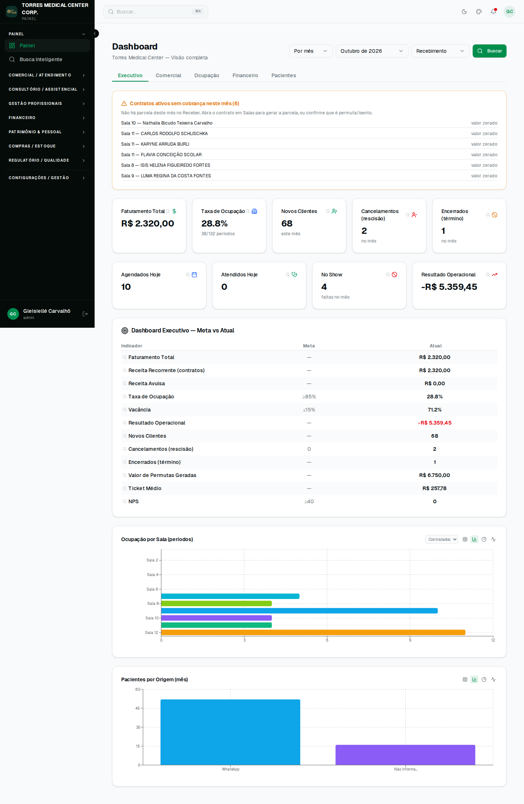
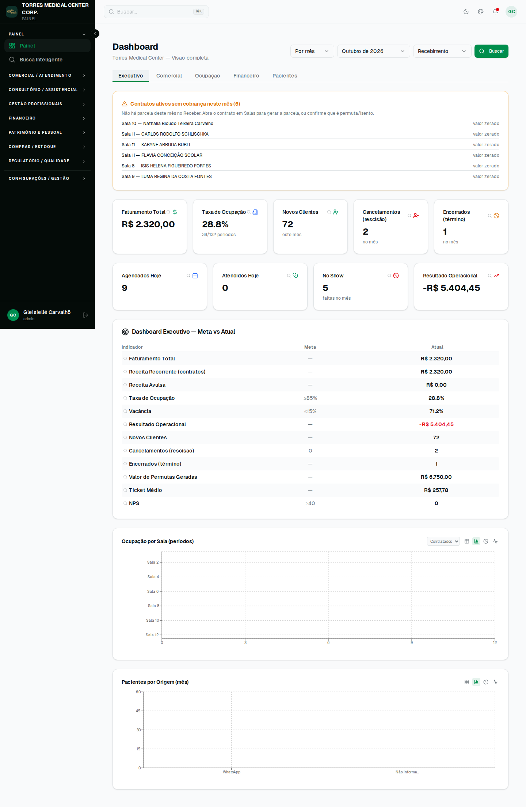
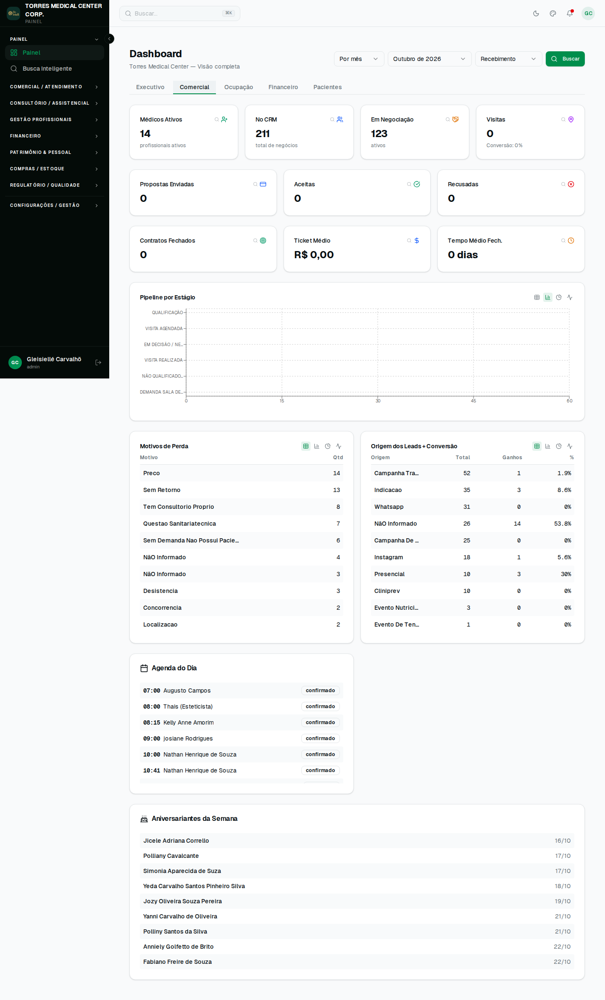
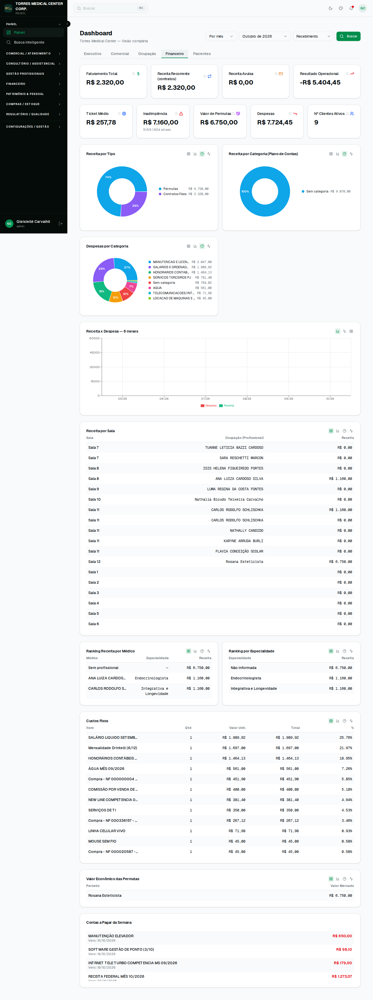
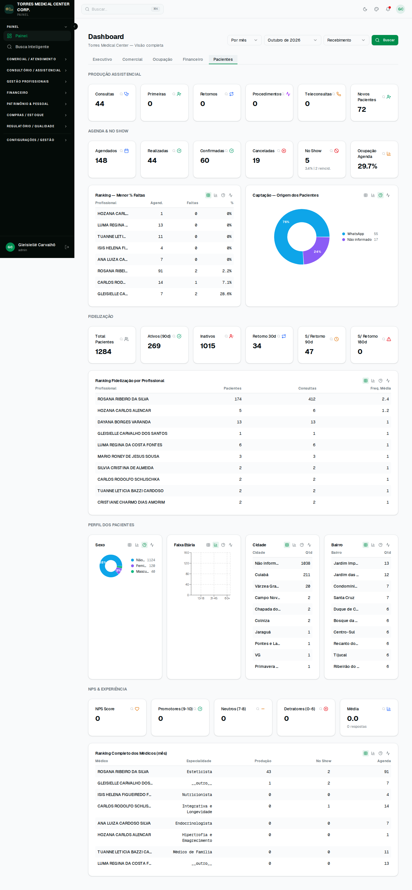

# Painel

- **Módulo:** PAINEL
- **Tela:** Painel
- **URL:** `/`
- **Título na página:** Dashboard

## Objetivo (inferido)

Tela "Painel" do módulo PAINEL. Possui 4 campo(s) de entrada/filtro. Texto de apoio: "Dashboard Torres Medical Center — Visão completa Por mês Outubro de 2026 Recebimento Buscar Executivo Comercial Ocupação Financeiro Pacientes Contratos ativos sem cobrança neste mês (6) Não há parcela…"

## Screenshot

## Campos

| Nome | Rótulo | Tipo | Obrigatório | Valores/opções |
|---|---|---|---|---|
| — | — | combobox | não indicado | — |
| — | — | combobox | não indicado | — |
| — | — | combobox | não indicado | — |
| — | — | select | não indicado | Contratados, Livres, Ocupação % |

## Botões e ações

- Buscar... ⌘K
- Toggle theme
- Customize theme
- Notifications
- GC
- Por mês
- Outubro de 2026
- Recebimento
- Buscar
- Executivo
- Comercial
- Ocupação
- Financeiro
- Pacientes
- Tabela
- Barras
- Pizza
- Linha

## Tabelas / grids

_Nenhuma tabela encontrada._

- Filtros/busca: não identificado
- Paginação: não identificada

## Abas

A tela tem 5 abas (botões no topo do dashboard). Prints capturados em 15/10/2026:

- Executivo
- Comercial
- Ocupação
- Financeiro
- Pacientes

### Executivo

### Comercial

### Ocupação

### Financeiro

### Pacientes

## Modais

_Nenhum modal aberto na carga da tela. Modais disparados por botões não foram abertos (regra somente-leitura)._

## Links para outras telas

_Nenhum link na área principal._

## Mensagens e validações visíveis

_Nenhuma mensagem visível._
