# Painel

- **Módulo:** PAINEL
- **Tela:** Painel
- **URL:** `/`
- **Título na página:** Dashboard

## Objetivo (inferido)

Tela "Painel" do módulo PAINEL. Possui 4 campo(s) de entrada/filtro. Texto de apoio: "Dashboard Torres Medical Center — Visão completa Por mês Outubro de 2026 Recebimento Buscar Executivo Comercial Ocupação Financeiro Pacientes Contratos ativos sem cobrança neste mês (6) Não há parcela…"

## Screenshot

## Campos

| Nome | Rótulo | Tipo | Obrigatório | Valores/opções |
|---|---|---|---|---|
| — | — | combobox | não indicado | — |
| — | — | combobox | não indicado | — |
| — | — | combobox | não indicado | — |
| — | — | select | não indicado | Contratados, Livres, Ocupação % |

## Botões e ações

- Buscar... ⌘K
- Toggle theme
- Customize theme
- Notifications
- GC
- Por mês
- Outubro de 2026
- Recebimento
- Buscar
- Executivo
- Comercial
- Ocupação
- Financeiro
- Pacientes
- Tabela
- Barras
- Pizza
- Linha

## Tabelas / grids

_Nenhuma tabela encontrada._

- Filtros/busca: não identificado
- Paginação: não identificada

## Abas

A tela tem 5 abas (botões no topo do dashboard). Prints capturados em 15/10/2026:

- Executivo
- Comercial
- Ocupação
- Financeiro
- Pacientes

### Executivo

### Comercial

### Ocupação

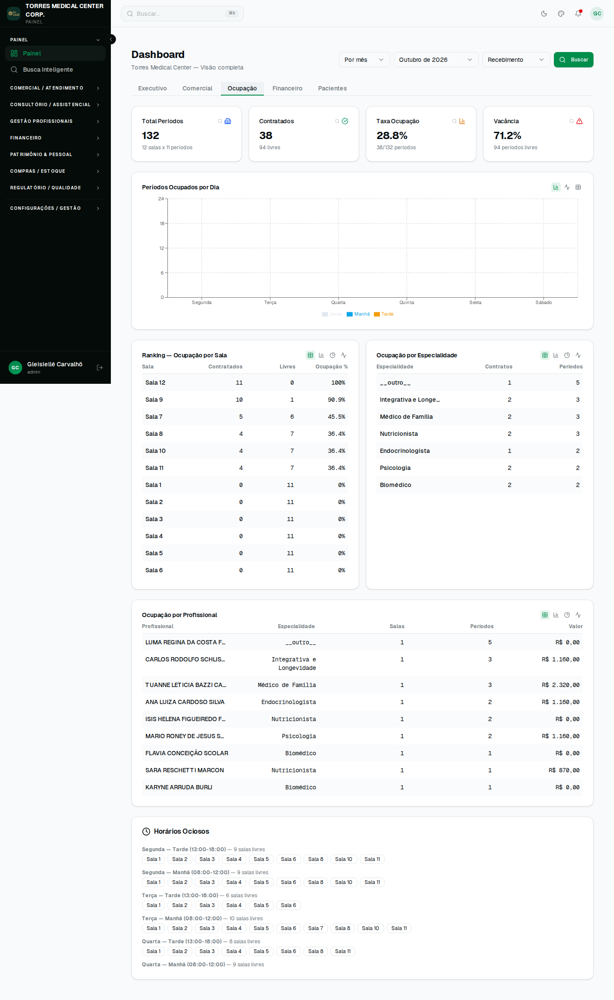

### Financeiro

### Pacientes

## Modais

_Nenhum modal aberto na carga da tela. Modais disparados por botões não foram abertos (regra somente-leitura)._

## Links para outras telas

_Nenhum link na área principal._

## Mensagens e validações visíveis

_Nenhuma mensagem visível._

<!-- estados -->
## Estados capturados (interações de visualização)

_Capturados em 15/10/2026 clicando só em itens de visualização do checklist da issue. Nenhum formulário foi preenchido e toda gravação foi bloqueada._

### Dropdown aberto: Por mês

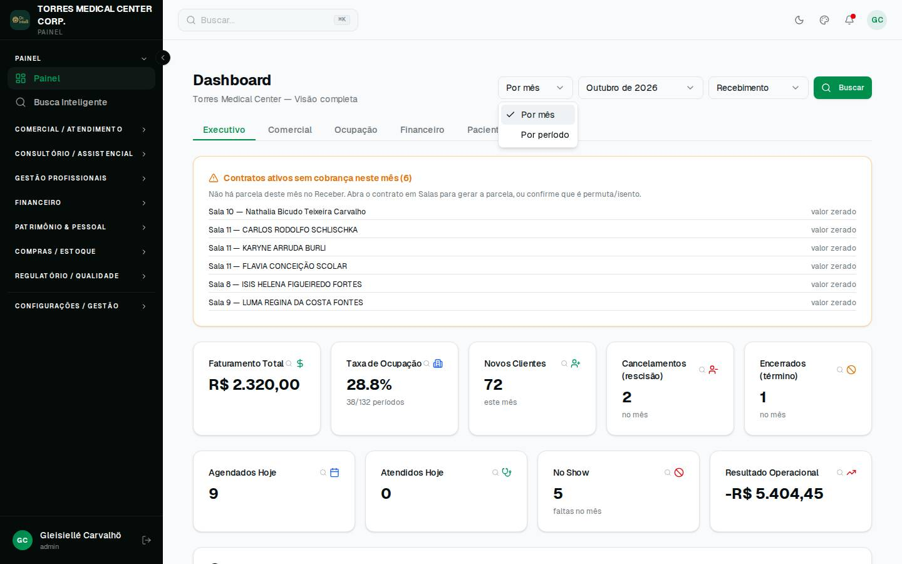

- Itens do menu/lista: Por mês · Por período

### Dropdown aberto: Outubro de 

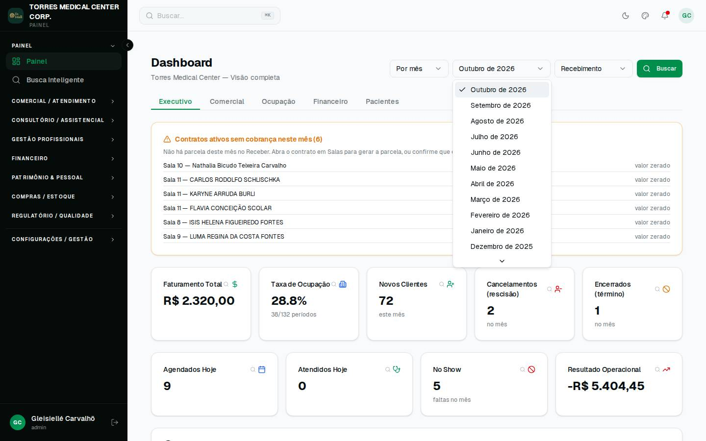

- Itens do menu/lista: Outubro de 2026 · Setembro de 2026 · Agosto de 2026 · Julho de 2026 · Junho de 2026 · Maio de 2026 · Abril de 2026 · Março de 2026 · Fevereiro de 2026 · Janeiro de 2026 · Dezembro de 2025 · Novembro de 2025 · Outubro de 2025 · Setembro de 2025 · Agosto de 2025 · Julho de 2025 · Junho de 2025 · Maio de 2025 · Abril de 2025 · Março de 2025 · Fevereiro de 2025 · Janeiro de 2025 · Dezembro de 2024 · Novembro de 2024

### Dropdown aberto: Recebimento

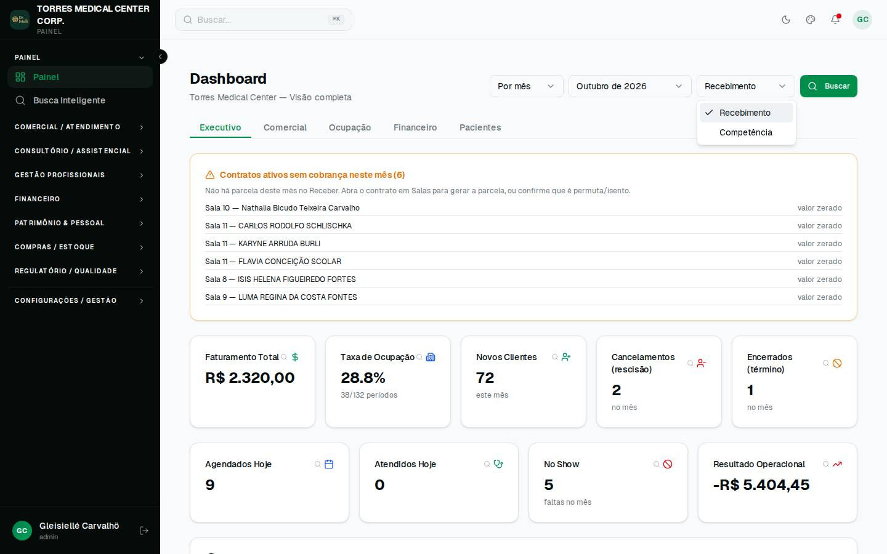

- Itens do menu/lista: Recebimento · Competência

### Buscar

### Executivo

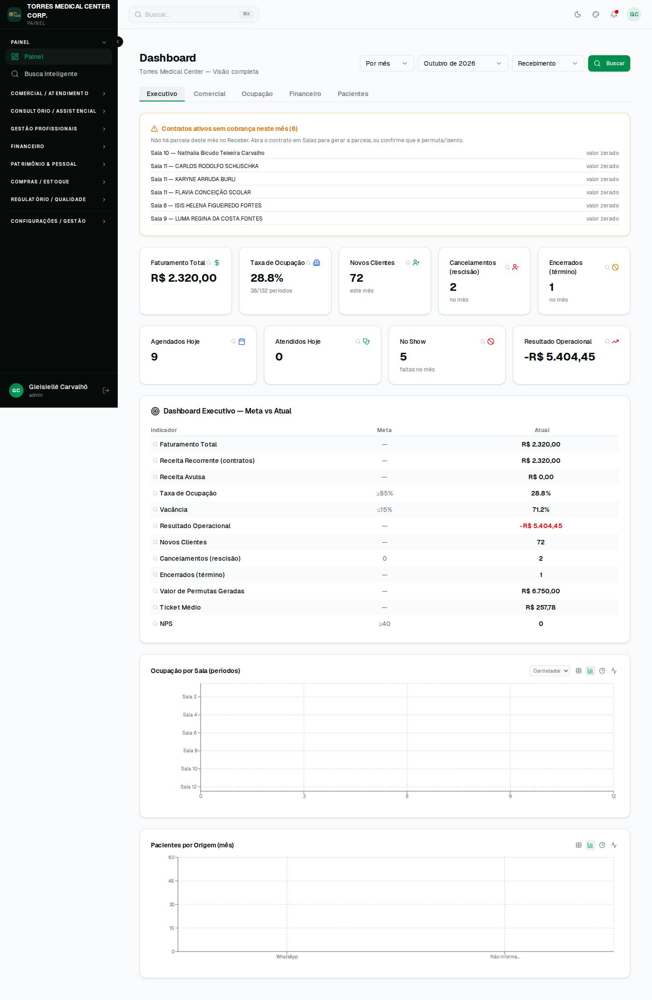

### Comercial

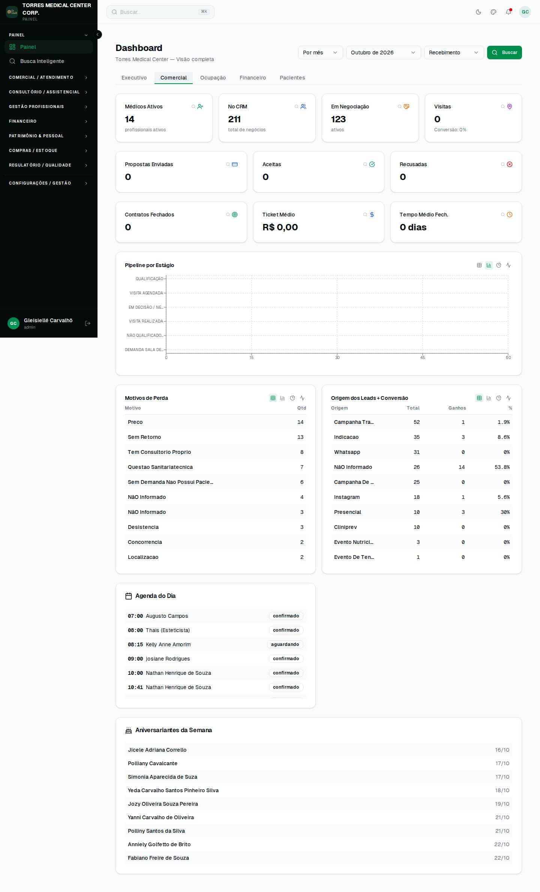

### Ocupação

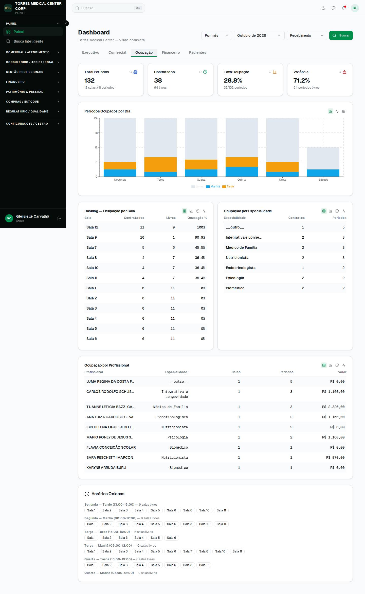

### Financeiro

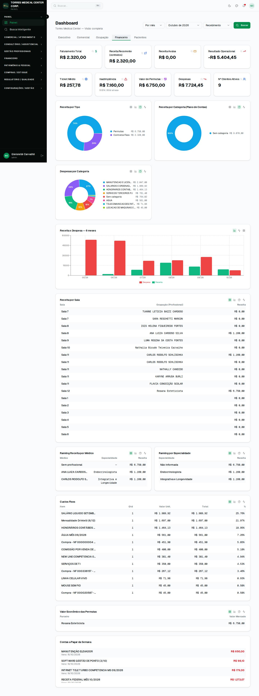

### Pacientes

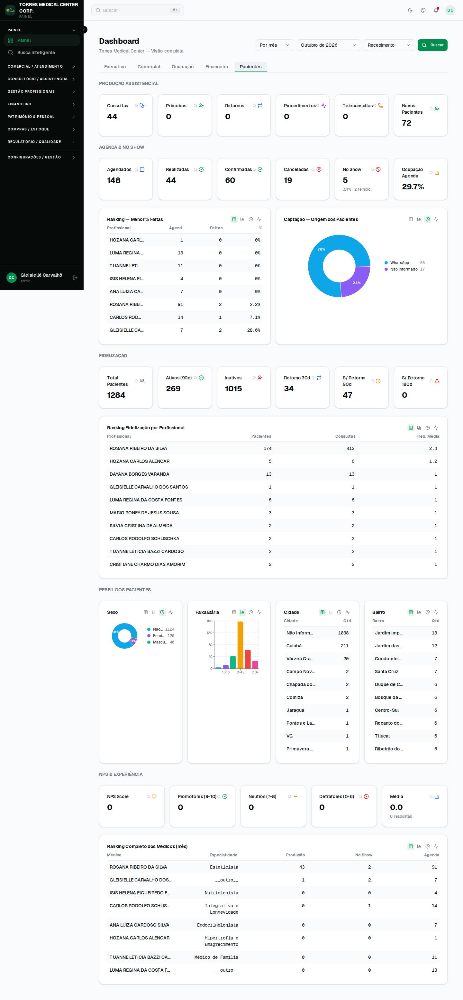

### Dropdown aberto: Contratados Livres Ocupação %

- select nativo: opções listadas, sem print
- Opções: Contratados, Livres, Ocupação %

### Tabela

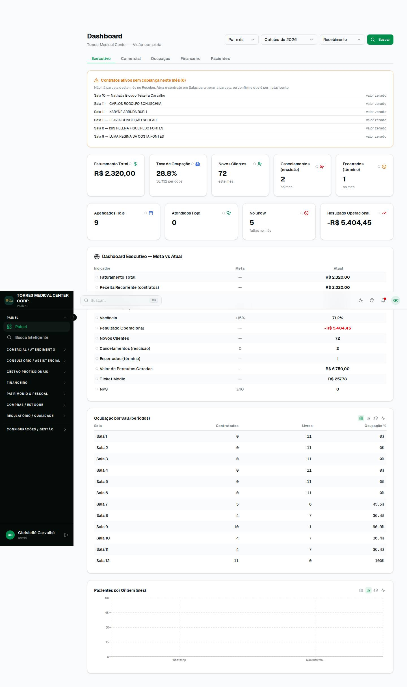

### Barras

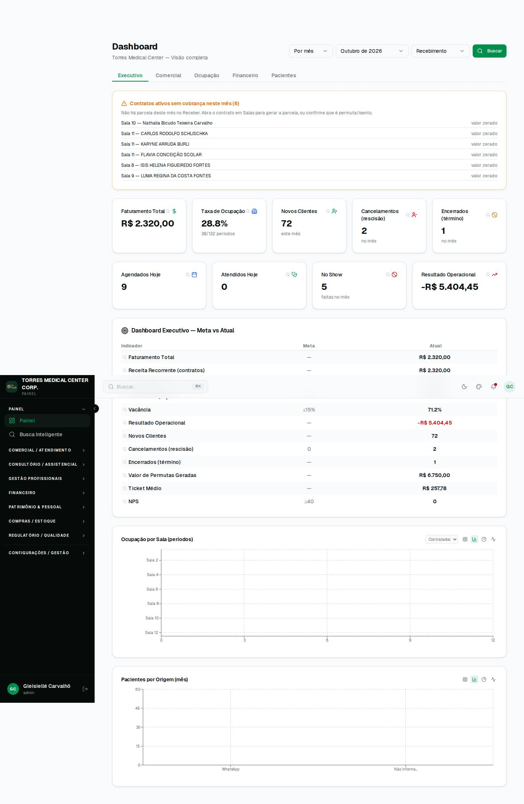

### Pizza

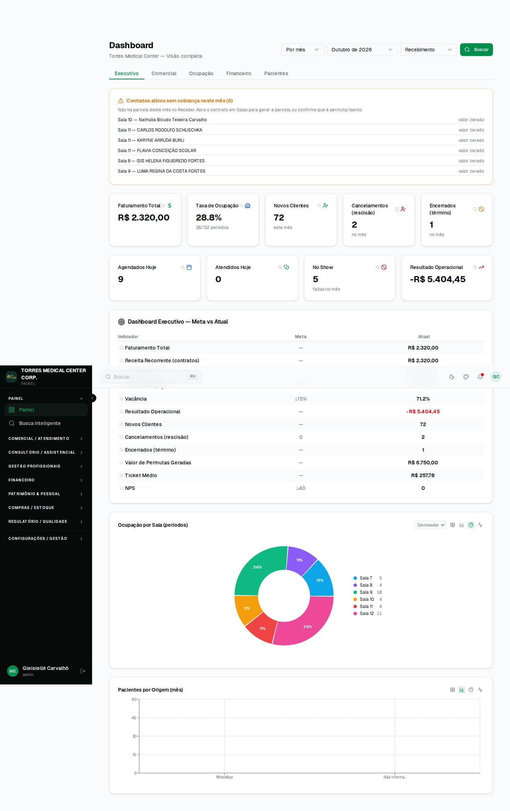

### Linha

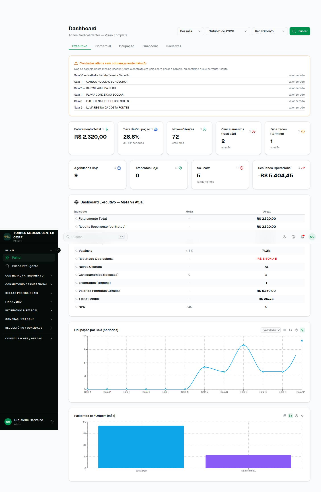

<!-- /estados -->
