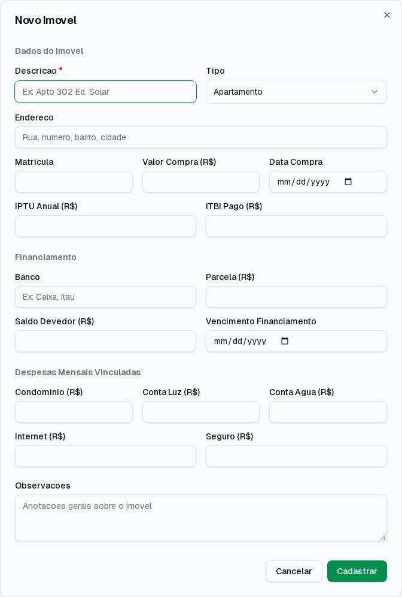
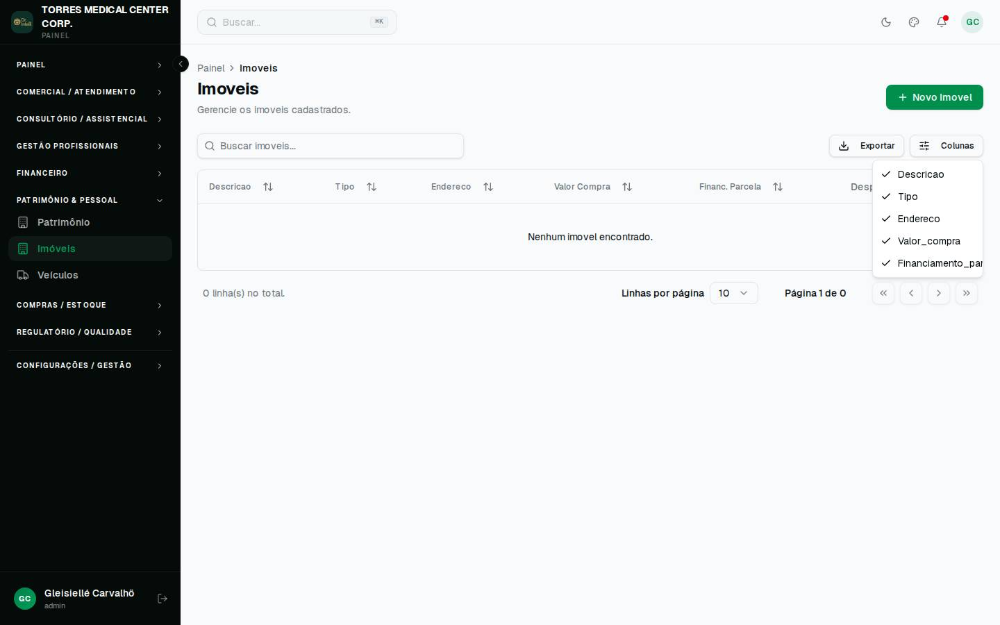
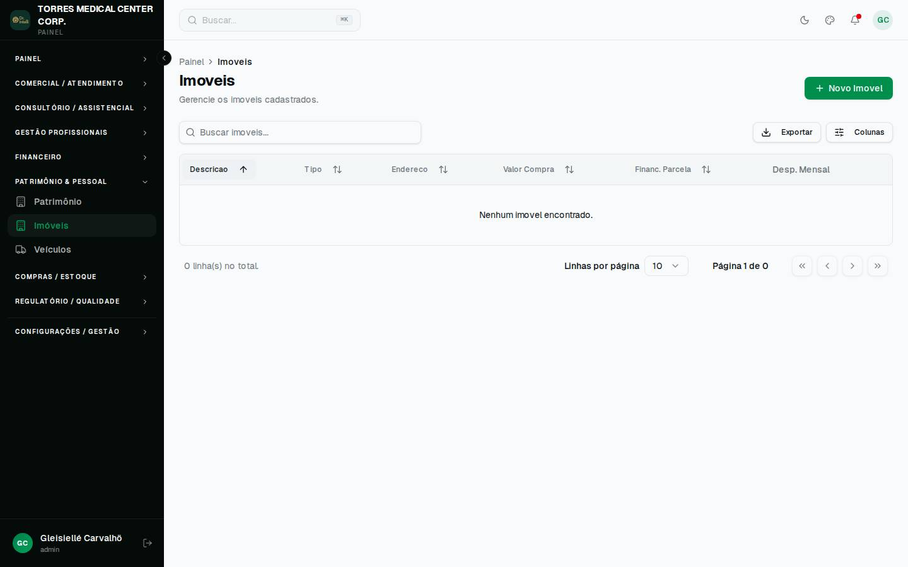

# Imóveis

- **Módulo:** PATRIMÔNIO & PESSOAL
- **Tela:** Imóveis
- **URL:** `/imoveis`
- **Título na página:** Imoveis

## Objetivo (inferido)

Tela "Imóveis" do módulo PATRIMÔNIO & PESSOAL. Apresenta listagem em tabela com colunas Descricao, Tipo, Endereco, Valor Compra, Financ. Parcela, Desp. Mensal. Possui 2 campo(s) de entrada/filtro. Texto de apoio: "Painel Imoveis Imoveis Gerencie os imoveis cadastrados. Novo Imovel Exportar Colunas Descricao Tipo Endereco Valor Compra Financ. Parcela Desp. Mensal Nenhum imovel encontrado. 0 linha(s) no total. Li…"

## Screenshot

## Campos

| Nome | Rótulo | Tipo | Obrigatório | Valores/opções |
|---|---|---|---|---|
| — | Buscar imoveis... | text | não indicado | — |
| — | — | combobox | não indicado | — |

## Botões e ações

- Buscar... ⌘K
- Toggle theme
- Customize theme
- Notifications
- GC
- Novo Imovel
- Exportar
- Colunas
- Descricao
- Tipo
- Endereco
- Valor Compra
- Financ. Parcela
- 10
- Ir para primeira página _(desabilitado)_
- Ir para página anterior _(desabilitado)_
- Ir para próxima página _(desabilitado)_
- Ir para última página _(desabilitado)_

## Tabelas / grids

**Tabela 1** — 1 linha(s) visível(is)

- Colunas: Descricao · Tipo · Endereco · Valor Compra · Financ. Parcela · Desp. Mensal
- Colunas possivelmente ordenáveis: Descricao, Tipo, Endereco, Valor Compra, Financ. Parcela

- Filtros/busca: Buscar imoveis...
- Paginação: Página 1 de 0

## Abas

_Nenhuma aba._

## Modais

_Nenhum modal aberto na carga da tela. Modais disparados por botões não foram abertos (regra somente-leitura)._

## Links para outras telas

- Painel → `/`

## Mensagens e validações visíveis

_Nenhuma mensagem visível._

<!-- estados -->
## Estados capturados (interações de visualização)

_Capturados em 15/10/2026 clicando só em itens de visualização do checklist da issue. Nenhum formulário foi preenchido e toda gravação foi bloqueada._

### Novo Imovel

- Abre modal **Novo Imovel**

| Campo | Tipo | Obrigatório | Opções |
|---|---|---|---|
| Descricao * | text | sim | — |
| Tipo | combobox | não indicado | — |
| Endereco | text | não indicado | — |
| Matricula | text | não indicado | — |
| Valor Compra (R$) | number | não indicado | — |
| Data Compra | date | não indicado | — |
| IPTU Anual (R$) | number | não indicado | — |
| ITBI Pago (R$) | number | não indicado | — |
| Banco | text | não indicado | — |
| Parcela (R$) | number | não indicado | — |
| Saldo Devedor (R$) | number | não indicado | — |
| Vencimento Financiamento | date | não indicado | — |
| Condominio (R$) | number | não indicado | — |
| Conta Luz (R$) | number | não indicado | — |
| Conta Agua (R$) | number | não indicado | — |
| Internet (R$) | number | não indicado | — |
| Seguro (R$) | number | não indicado | — |
| Observacoes | textarea | não indicado | — |

- Botões do modal: Apartamento · Cancelar · Cadastrar · Close

### Colunas

- Itens do menu/lista: Descricao · Tipo · Endereco · Valor_compra · Financiamento_parcela

### Ordenação por coluna — 1 print de exemplo (colunas: Descricao, Tipo, Endereco, Valor Compra, Financ. Parcela)

### Paginação — 1 print da página 2

- lista com uma página só (botão de próxima página desabilitado), sem print

<!-- /estados -->
