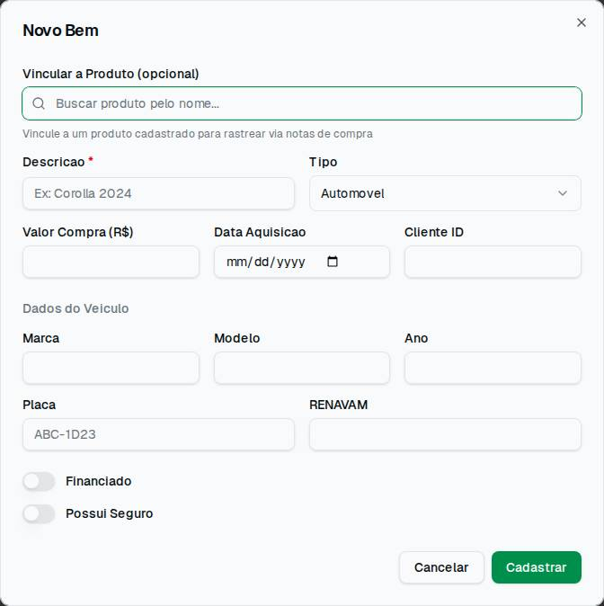
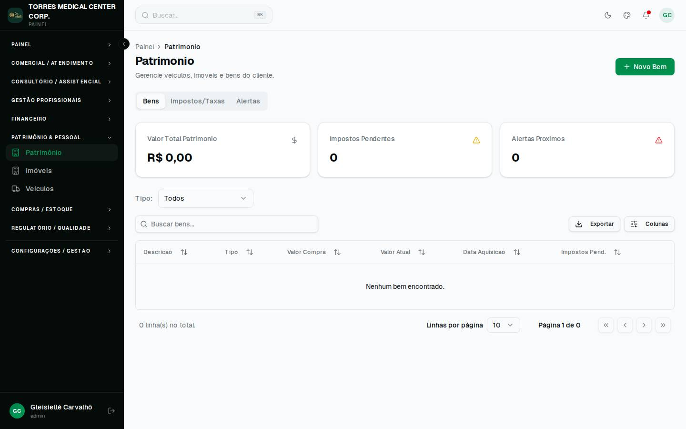
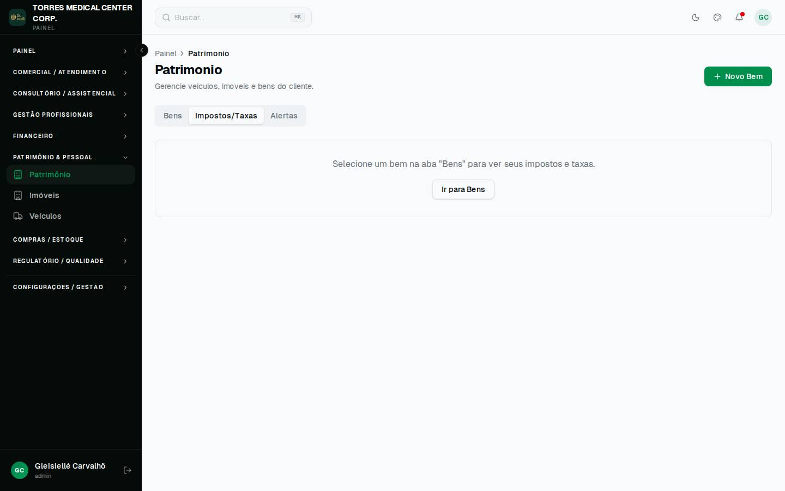
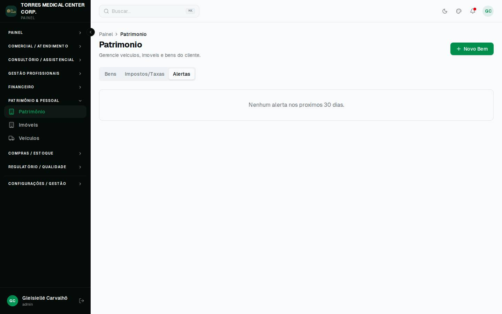
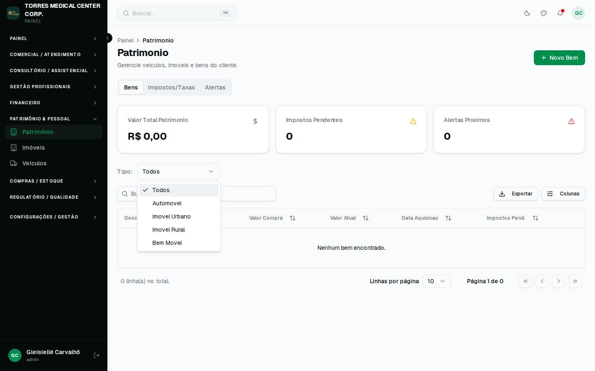
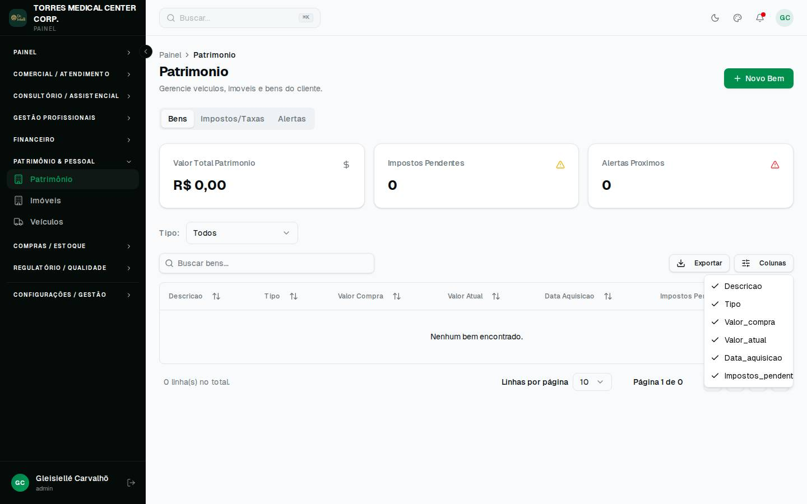
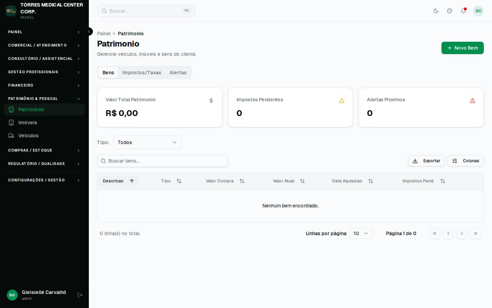

# Patrimônio

- **Módulo:** PATRIMÔNIO & PESSOAL
- **Tela:** Patrimônio
- **URL:** `/patrimonio`
- **Título na página:** Patrimonio

## Objetivo (inferido)

Tela "Patrimônio" do módulo PATRIMÔNIO & PESSOAL. Apresenta listagem em tabela com colunas Descricao, Tipo, Valor Compra, Valor Atual, Data Aquisicao, Impostos Pend.. Possui 3 campo(s) de entrada/filtro. Organizada em abas (Bens, Impostos/Taxas, Alertas). Texto de apoio: "Painel Patrimonio Patrimonio Gerencie veiculos, imoveis e bens do cliente. Novo Bem Bens Impostos/Taxas Alertas Valor Total Patrimonio R$ 0,00 Impostos Pendentes 0 Alertas Proximos 0 Tipo: Todos Expor…"

## Screenshot

## Campos

| Nome | Rótulo | Tipo | Obrigatório | Valores/opções |
|---|---|---|---|---|
| — | Tipo: | combobox | não indicado | — |
| — | Buscar bens... | text | não indicado | — |
| — | — | combobox | não indicado | — |

## Botões e ações

- Buscar... ⌘K
- Toggle theme
- Customize theme
- Notifications
- GC
- Novo Bem
- Bens
- Impostos/Taxas
- Alertas
- Todos
- Exportar
- Colunas
- Descricao
- Tipo
- Valor Compra
- Valor Atual
- Data Aquisicao
- Impostos Pend.
- 10
- Ir para primeira página _(desabilitado)_
- Ir para página anterior _(desabilitado)_
- Ir para próxima página _(desabilitado)_
- Ir para última página _(desabilitado)_

## Tabelas / grids

**Tabela 1** — 1 linha(s) visível(is)

- Colunas: Descricao · Tipo · Valor Compra · Valor Atual · Data Aquisicao · Impostos Pend.
- Colunas possivelmente ordenáveis: Descricao, Tipo, Valor Compra, Valor Atual, Data Aquisicao, Impostos Pend.

- Filtros/busca: Tipo:, Buscar bens...
- Paginação: Página 1 de 0

## Abas

- Bens _(ativa)_
- Impostos/Taxas
- Alertas

## Modais

_Nenhum modal aberto na carga da tela. Modais disparados por botões não foram abertos (regra somente-leitura)._

## Links para outras telas

- Painel → `/`

## Mensagens e validações visíveis

_Nenhuma mensagem visível._

<!-- estados -->
## Estados capturados (interações de visualização)

_Capturados em 15/10/2026 clicando só em itens de visualização do checklist da issue. Nenhum formulário foi preenchido e toda gravação foi bloqueada._

### Novo Bem

- Abre modal **Novo Bem**

| Campo | Tipo | Obrigatório | Opções |
|---|---|---|---|
| Buscar produto pelo nome... | text | não indicado | — |
| Descricao * | text | sim | — |
| Tipo | combobox | não indicado | — |
| Valor Compra (R$) | number | não indicado | — |
| Data Aquisicao | date | não indicado | — |
| Cliente ID | number | não indicado | — |
| Marca | text | não indicado | — |
| Modelo | text | não indicado | — |
| Ano | number | não indicado | — |
| Placa | text | não indicado | — |
| RENAVAM | text | não indicado | — |
| Financiado | switch | não indicado | — |
| Possui Seguro | switch | não indicado | — |

- Botões do modal: Automovel · Cancelar · Cadastrar · Close

### Aba: Bens

### Aba: Impostos/Taxas

### Aba: Alertas

### Dropdown aberto: Todos

- Itens do menu/lista: Todos · Automovel · Imovel Urbano · Imovel Rural · Bem Movel

### Colunas

- Itens do menu/lista: Descricao · Tipo · Valor_compra · Valor_atual · Data_aquisicao · Impostos_pendentes

### Ordenação por coluna — 1 print de exemplo (colunas: Descricao, Tipo, Valor Compra, Valor Atual, Data Aquisicao, Impostos Pend.)

### Paginação — 1 print da página 2

- lista com uma página só (botão de próxima página desabilitado), sem print

<!-- /estados -->
