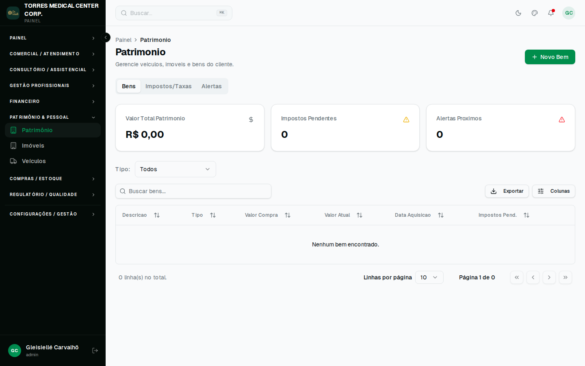

# Patrimônio

- **Módulo:** PATRIMÔNIO & PESSOAL
- **Tela:** Patrimônio
- **URL:** `/patrimonio`
- **Título na página:** Patrimonio

## Objetivo (inferido)

Tela "Patrimônio" do módulo PATRIMÔNIO & PESSOAL. Apresenta listagem em tabela com colunas Descricao, Tipo, Valor Compra, Valor Atual, Data Aquisicao, Impostos Pend.. Possui 3 campo(s) de entrada/filtro. Organizada em abas (Bens, Impostos/Taxas, Alertas). Texto de apoio: "Painel Patrimonio Patrimonio Gerencie veiculos, imoveis e bens do cliente. Novo Bem Bens Impostos/Taxas Alertas Valor Total Patrimonio R$ 0,00 Impostos Pendentes 0 Alertas Proximos 0 Tipo: Todos Expor…"

## Screenshot

## Campos

| Nome | Rótulo | Tipo | Obrigatório | Valores/opções |
|---|---|---|---|---|
| — | Tipo: | combobox | não indicado | — |
| — | Buscar bens... | text | não indicado | — |
| — | — | combobox | não indicado | — |

## Botões e ações

- Buscar... ⌘K
- Toggle theme
- Customize theme
- Notifications
- GC
- Novo Bem
- Bens
- Impostos/Taxas
- Alertas
- Todos
- Exportar
- Colunas
- Descricao
- Tipo
- Valor Compra
- Valor Atual
- Data Aquisicao
- Impostos Pend.
- 10
- Ir para primeira página _(desabilitado)_
- Ir para página anterior _(desabilitado)_
- Ir para próxima página _(desabilitado)_
- Ir para última página _(desabilitado)_

## Tabelas / grids

**Tabela 1** — 1 linha(s) visível(is)

- Colunas: Descricao · Tipo · Valor Compra · Valor Atual · Data Aquisicao · Impostos Pend.
- Colunas possivelmente ordenáveis: Descricao, Tipo, Valor Compra, Valor Atual, Data Aquisicao, Impostos Pend.

- Filtros/busca: Tipo:, Buscar bens...
- Paginação: Página 1 de 0

## Abas

- Bens _(ativa)_
- Impostos/Taxas
- Alertas

## Modais

_Nenhum modal aberto na carga da tela. Modais disparados por botões não foram abertos (regra somente-leitura)._

## Links para outras telas

- Painel → `/`

## Mensagens e validações visíveis

_Nenhuma mensagem visível._
