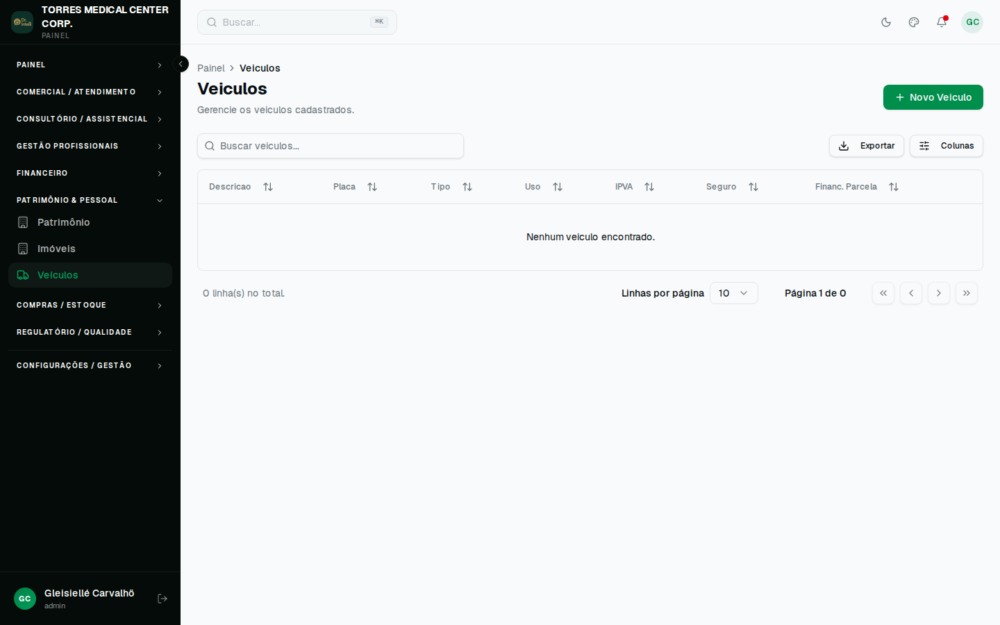
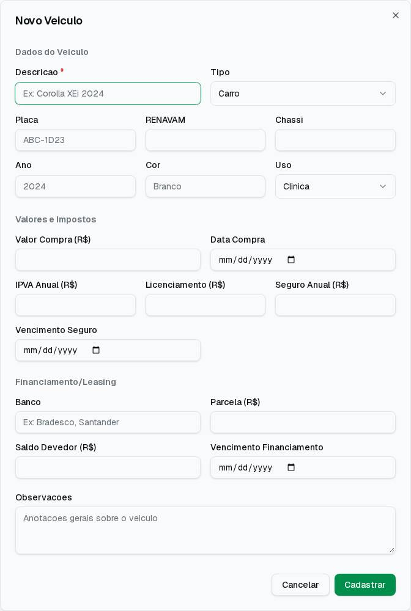
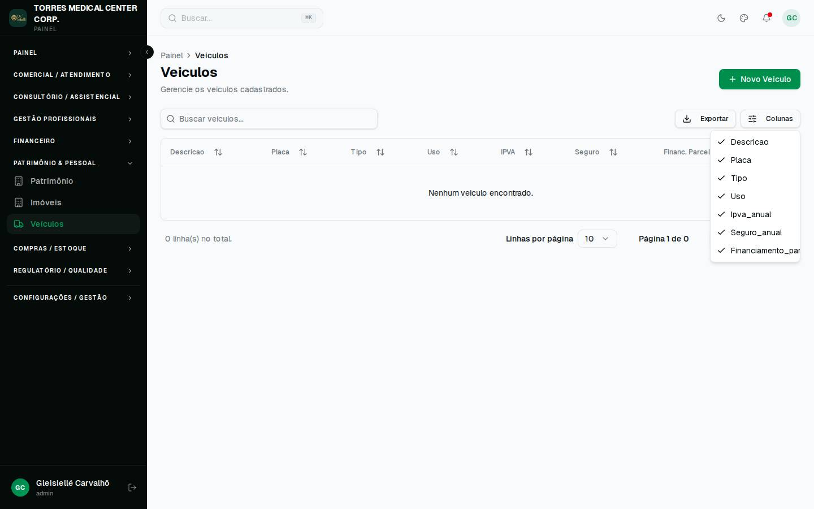
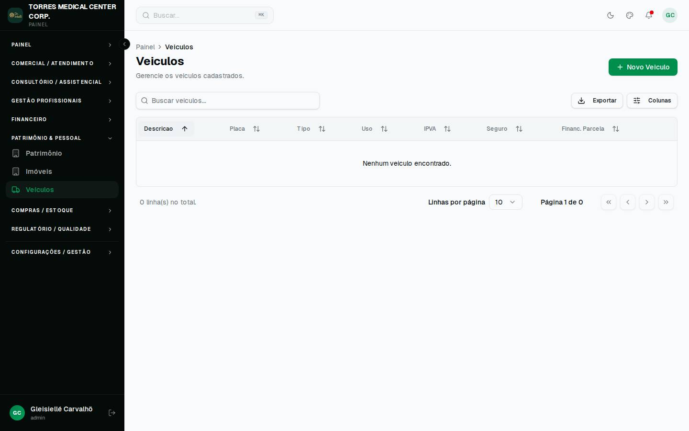

# Veículos

- **Módulo:** PATRIMÔNIO & PESSOAL
- **Tela:** Veículos
- **URL:** `/veiculos`
- **Título na página:** Veiculos

## Objetivo (inferido)

Tela "Veículos" do módulo PATRIMÔNIO & PESSOAL. Apresenta listagem em tabela com colunas Descricao, Placa, Tipo, Uso, IPVA, Seguro. Possui 2 campo(s) de entrada/filtro. Texto de apoio: "Painel Veiculos Veiculos Gerencie os veiculos cadastrados. Novo Veiculo Exportar Colunas Descricao Placa Tipo Uso IPVA Seguro Financ. Parcela Nenhum veiculo encontrado. 0 linha(s) no total. Linhas por…"

## Screenshot

## Campos

| Nome | Rótulo | Tipo | Obrigatório | Valores/opções |
|---|---|---|---|---|
| — | Buscar veiculos... | text | não indicado | — |
| — | — | combobox | não indicado | — |

## Botões e ações

- Buscar... ⌘K
- Toggle theme
- Customize theme
- Notifications
- GC
- Novo Veiculo
- Exportar
- Colunas
- Descricao
- Placa
- Tipo
- Uso
- IPVA
- Seguro
- Financ. Parcela
- 10
- Ir para primeira página _(desabilitado)_
- Ir para página anterior _(desabilitado)_
- Ir para próxima página _(desabilitado)_
- Ir para última página _(desabilitado)_

## Tabelas / grids

**Tabela 1** — 1 linha(s) visível(is)

- Colunas: Descricao · Placa · Tipo · Uso · IPVA · Seguro · Financ. Parcela
- Colunas possivelmente ordenáveis: Descricao, Placa, Tipo, Uso, IPVA, Seguro, Financ. Parcela

- Filtros/busca: Buscar veiculos...
- Paginação: Página 1 de 0

## Abas

_Nenhuma aba._

## Modais

_Nenhum modal aberto na carga da tela. Modais disparados por botões não foram abertos (regra somente-leitura)._

## Links para outras telas

- Painel → `/`

## Mensagens e validações visíveis

_Nenhuma mensagem visível._

<!-- estados -->
## Estados capturados (interações de visualização)

_Capturados em 15/10/2026 clicando só em itens de visualização do checklist da issue. Nenhum formulário foi preenchido e toda gravação foi bloqueada._

### Novo Veiculo

- Abre modal **Novo Veiculo**

| Campo | Tipo | Obrigatório | Opções |
|---|---|---|---|
| Descricao * | text | sim | — |
| Tipo | combobox | não indicado | — |
| Placa | text | não indicado | — |
| RENAVAM | text | não indicado | — |
| Chassi | text | não indicado | — |
| Ano | number | não indicado | — |
| Cor | text | não indicado | — |
| Uso | combobox | não indicado | — |
| Valor Compra (R$) | number | não indicado | — |
| Data Compra | date | não indicado | — |
| IPVA Anual (R$) | number | não indicado | — |
| Licenciamento (R$) | number | não indicado | — |
| Seguro Anual (R$) | number | não indicado | — |
| Vencimento Seguro | date | não indicado | — |
| Banco | text | não indicado | — |
| Parcela (R$) | number | não indicado | — |
| Saldo Devedor (R$) | number | não indicado | — |
| Vencimento Financiamento | date | não indicado | — |
| Observacoes | textarea | não indicado | — |

- Botões do modal: Carro · Clinica · Cancelar · Cadastrar · Close

### Colunas

- Itens do menu/lista: Descricao · Placa · Tipo · Uso · Ipva_anual · Seguro_anual · Financiamento_parcela

### Ordenação por coluna — 1 print de exemplo (colunas: Descricao, Placa, Tipo, Uso, IPVA, Seguro, Financ. Parcela)

### Paginação — 1 print da página 2

- lista com uma página só (botão de próxima página desabilitado), sem print

<!-- /estados -->
