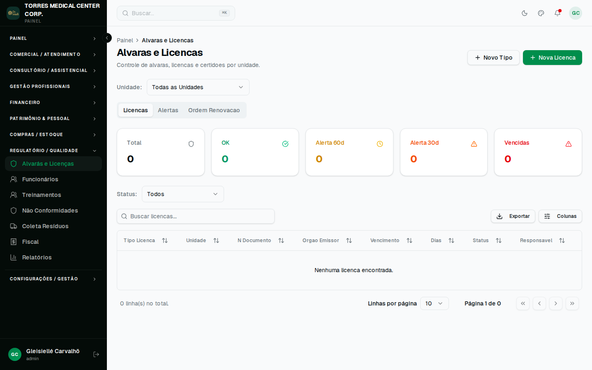
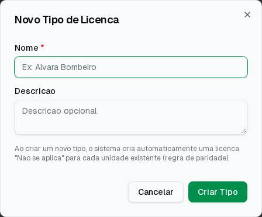
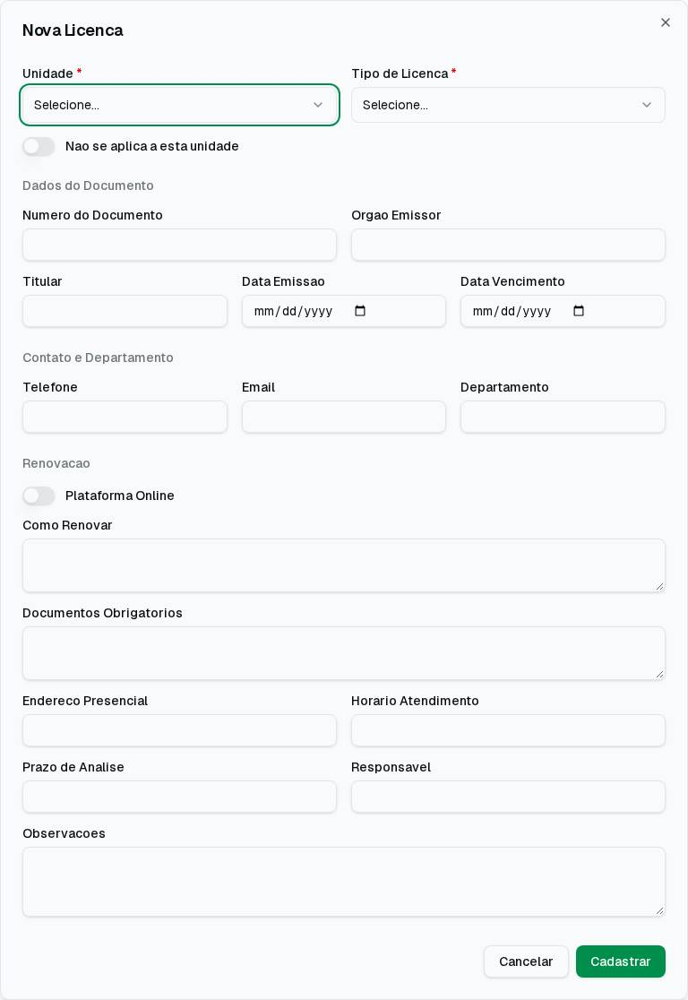
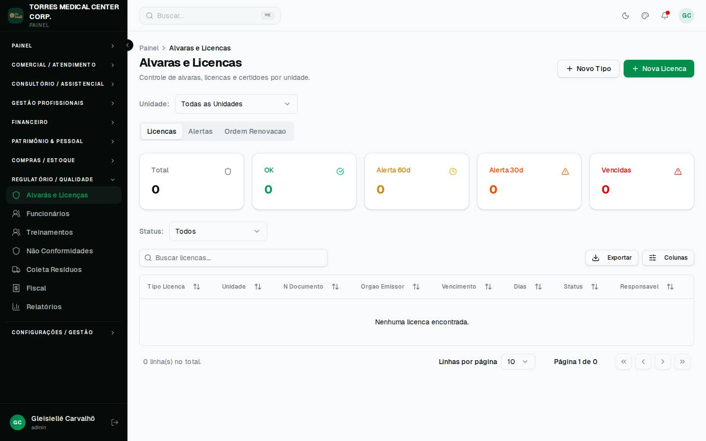
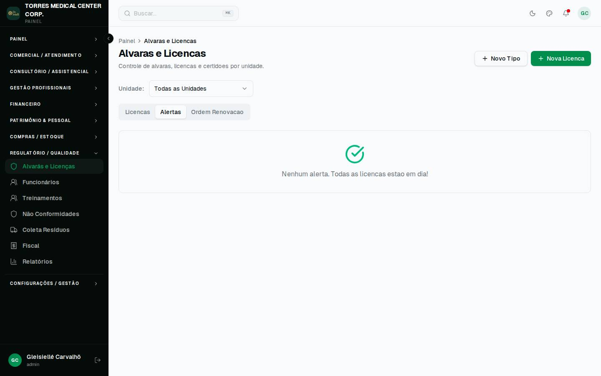
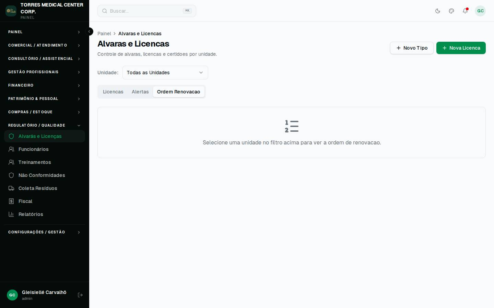
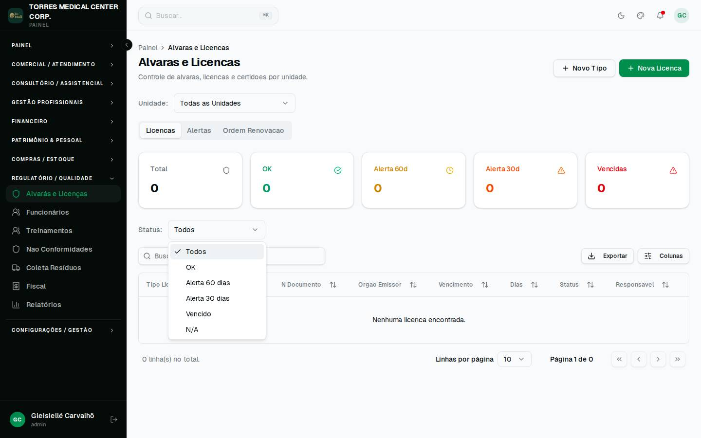
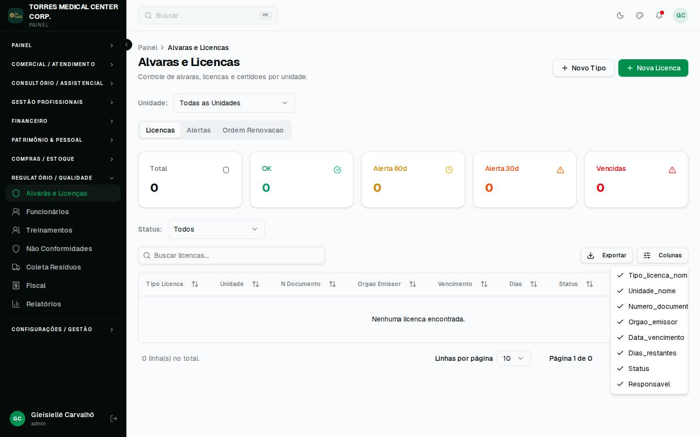

# Alvarás e Licenças

- **Módulo:** REGULATÓRIO / QUALIDADE
- **Tela:** Alvarás e Licenças
- **URL:** `/alvaras`
- **Título na página:** Alvaras e Licencas

## Objetivo (inferido)

Tela "Alvarás e Licenças" do módulo REGULATÓRIO / QUALIDADE. Apresenta listagem em tabela com colunas Tipo Licenca, Unidade, N Documento, Orgao Emissor, Vencimento, Dias. Possui 4 campo(s) de entrada/filtro. Organizada em abas (Licencas, Alertas, Ordem Renovacao). Texto de apoio: "Painel Alvaras e Licencas Alvaras e Licencas Controle de alvaras, licencas e certidoes por unidade. Novo Tipo Nova Licenca Unidade: Todas as Unidades Licencas Alertas Ordem Renovacao Total 0 OK 0 Aler…"

## Screenshot

## Campos

| Nome | Rótulo | Tipo | Obrigatório | Valores/opções |
|---|---|---|---|---|
| — | Unidade: | combobox | não indicado | — |
| — | Status: | combobox | não indicado | — |
| — | Buscar licencas... | text | não indicado | — |
| — | — | combobox | não indicado | — |

## Botões e ações

- Buscar... ⌘K
- Toggle theme
- Customize theme
- Notifications
- GC
- Novo Tipo
- Nova Licenca
- Todas as Unidades
- Licencas
- Alertas
- Ordem Renovacao
- Todos
- Exportar
- Colunas
- Tipo Licenca
- Unidade
- N Documento
- Orgao Emissor
- Vencimento
- Dias
- Status
- Responsavel
- 10
- Ir para primeira página _(desabilitado)_
- Ir para página anterior _(desabilitado)_
- Ir para próxima página _(desabilitado)_
- Ir para última página _(desabilitado)_

## Tabelas / grids

**Tabela 1** — 1 linha(s) visível(is)

- Colunas: Tipo Licenca · Unidade · N Documento · Orgao Emissor · Vencimento · Dias · Status · Responsavel
- Colunas possivelmente ordenáveis: Tipo Licenca, Unidade, N Documento, Orgao Emissor, Vencimento, Dias, Status, Responsavel

- Filtros/busca: Unidade:, Status:, Buscar licencas...
- Paginação: Página 1 de 0

## Abas

- Licencas _(ativa)_
- Alertas
- Ordem Renovacao

## Modais

_Nenhum modal aberto na carga da tela. Modais disparados por botões não foram abertos (regra somente-leitura)._

## Links para outras telas

- Painel → `/`

## Mensagens e validações visíveis

_Nenhuma mensagem visível._

<!-- estados -->
## Estados capturados (interações de visualização)

_Capturados em 15/10/2026 clicando só em itens de visualização do checklist da issue. Nenhum formulário foi preenchido e toda gravação foi bloqueada._

### Novo Tipo

- Abre modal **Novo Tipo de Licenca**

| Campo | Tipo | Obrigatório | Opções |
|---|---|---|---|
| Nome * | text | sim | — |
| Descricao | textarea | não indicado | — |

- Botões do modal: Cancelar · Criar Tipo · Close

### Nova Licenca

- Abre modal **Nova Licenca**

| Campo | Tipo | Obrigatório | Opções |
|---|---|---|---|
| Unidade * | combobox | sim | — |
| Tipo de Licenca * | combobox | sim | — |
| Nao se aplica a esta unidade | switch | não indicado | — |
| Numero do Documento | text | não indicado | — |
| Orgao Emissor | text | não indicado | — |
| Titular | text | não indicado | — |
| Data Emissao | date | não indicado | — |
| Data Vencimento | date | não indicado | — |
| Telefone | text | não indicado | — |
| Email | email | não indicado | — |
| Departamento | text | não indicado | — |
| Plataforma Online | switch | não indicado | — |
| Como Renovar | textarea | não indicado | — |
| Documentos Obrigatorios | textarea | não indicado | — |
| Endereco Presencial | text | não indicado | — |
| Horario Atendimento | text | não indicado | — |
| Prazo de Analise | text | não indicado | — |
| Responsavel | text | não indicado | — |
| Observacoes | textarea | não indicado | — |

- Botões do modal: Selecione... · Cancelar · Cadastrar · Close

### Dropdown aberto: Todas as Unidades

- Itens do menu/lista: Todas as Unidades

### Aba: Licencas

### Aba: Alertas

### Aba: Ordem Renovacao

### Dropdown aberto: Todos

- Itens do menu/lista: Todos · OK · Alerta 60 dias · Alerta 30 dias · Vencido · N/A

### Colunas

- Itens do menu/lista: Tipo_licenca_nome · Unidade_nome · Numero_documento · Orgao_emissor · Data_vencimento · Dias_restantes · Status · Responsavel

### Ordenação por coluna — 1 print de exemplo (colunas: Tipo Licenca, Unidade, N Documento, Orgao Emissor, Vencimento, Dias, Status, Responsavel)

### Paginação — 1 print da página 2

- lista com uma página só (botão de próxima página desabilitado), sem print

<!-- /estados -->
