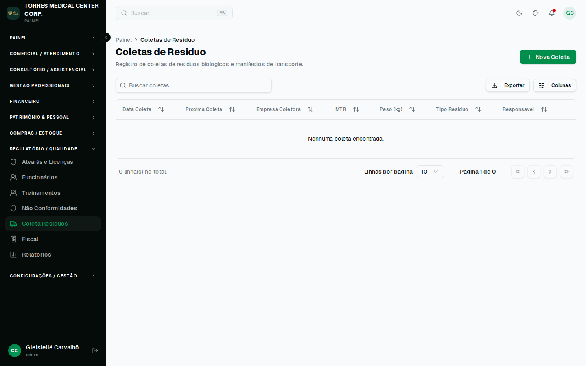
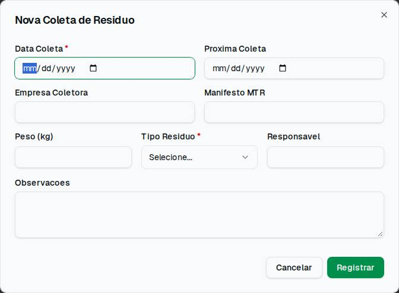
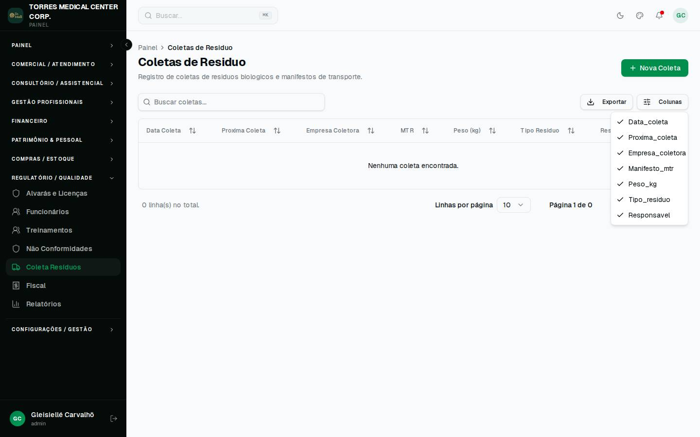
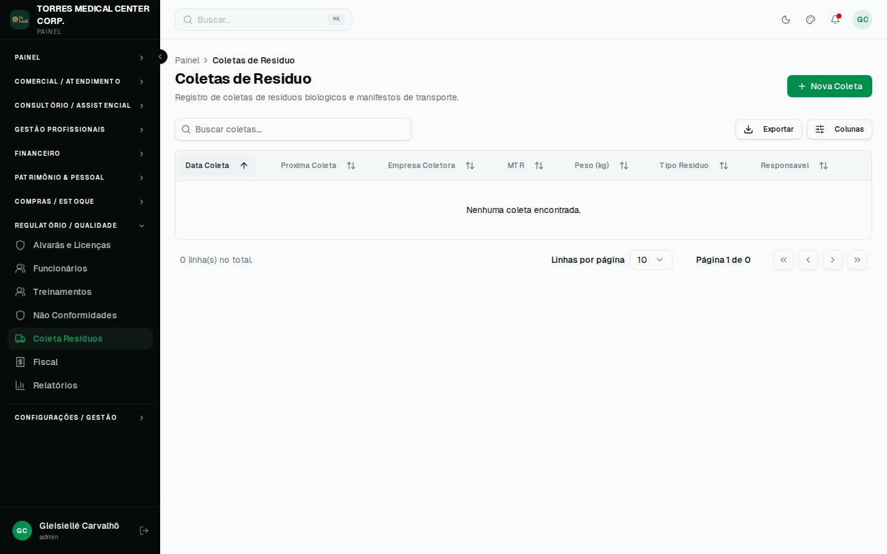

# Coleta Resíduos

- **Módulo:** REGULATÓRIO / QUALIDADE
- **Tela:** Coleta Resíduos
- **URL:** `/coletas-residuo`
- **Título na página:** Coletas de Residuo

## Objetivo (inferido)

Tela "Coleta Resíduos" do módulo REGULATÓRIO / QUALIDADE. Apresenta listagem em tabela com colunas Data Coleta, Proxima Coleta, Empresa Coletora, MTR, Peso (kg), Tipo Residuo. Possui 2 campo(s) de entrada/filtro. Texto de apoio: "Painel Coletas de Residuo Coletas de Residuo Registro de coletas de residuos biologicos e manifestos de transporte. Nova Coleta Exportar Colunas Data Coleta Proxima Coleta Empresa Coletora MTR Peso (k…"

## Screenshot

## Campos

| Nome | Rótulo | Tipo | Obrigatório | Valores/opções |
|---|---|---|---|---|
| — | Buscar coletas... | text | não indicado | — |
| — | — | combobox | não indicado | — |

## Botões e ações

- Buscar... ⌘K
- Toggle theme
- Customize theme
- Notifications
- GC
- Nova Coleta
- Exportar
- Colunas
- Data Coleta
- Proxima Coleta
- Empresa Coletora
- MTR
- Peso (kg)
- Tipo Residuo
- Responsavel
- 10
- Ir para primeira página _(desabilitado)_
- Ir para página anterior _(desabilitado)_
- Ir para próxima página _(desabilitado)_
- Ir para última página _(desabilitado)_

## Tabelas / grids

**Tabela 1** — 1 linha(s) visível(is)

- Colunas: Data Coleta · Proxima Coleta · Empresa Coletora · MTR · Peso (kg) · Tipo Residuo · Responsavel
- Colunas possivelmente ordenáveis: Data Coleta, Proxima Coleta, Empresa Coletora, MTR, Peso (kg), Tipo Residuo, Responsavel

- Filtros/busca: Buscar coletas...
- Paginação: Página 1 de 0

## Abas

_Nenhuma aba._

## Modais

_Nenhum modal aberto na carga da tela. Modais disparados por botões não foram abertos (regra somente-leitura)._

## Links para outras telas

- Painel → `/`

## Mensagens e validações visíveis

_Nenhuma mensagem visível._

<!-- estados -->
## Estados capturados (interações de visualização)

_Capturados em 15/10/2026 clicando só em itens de visualização do checklist da issue. Nenhum formulário foi preenchido e toda gravação foi bloqueada._

### Nova Coleta

- Abre modal **Nova Coleta de Residuo**

| Campo | Tipo | Obrigatório | Opções |
|---|---|---|---|
| Data Coleta * | date | sim | — |
| Proxima Coleta | date | não indicado | — |
| Empresa Coletora | text | não indicado | — |
| Manifesto MTR | text | não indicado | — |
| Peso (kg) | number | não indicado | — |
| Tipo Residuo * | combobox | sim | — |
| Responsavel | text | não indicado | — |
| Observacoes | textarea | não indicado | — |

- Botões do modal: Selecione... · Cancelar · Registrar · Close

### Colunas

- Itens do menu/lista: Data_coleta · Proxima_coleta · Empresa_coletora · Manifesto_mtr · Peso_kg · Tipo_residuo · Responsavel

### Ordenação por coluna — 1 print de exemplo (colunas: Data Coleta, Proxima Coleta, Empresa Coletora, MTR, Peso (kg), Tipo Residuo, Responsavel)

### Paginação — 1 print da página 2

- lista com uma página só (botão de próxima página desabilitado), sem print

<!-- /estados -->
