# Fiscal

- **Módulo:** REGULATÓRIO / QUALIDADE
- **Tela:** Fiscal
- **URL:** `/fiscal`
- **Título na página:** Fiscal

## Objetivo (inferido)

Tela "Fiscal" do módulo REGULATÓRIO / QUALIDADE. Apresenta listagem em tabela com colunas Tipo, Numero, Serie, Cliente, Valor, Status. Possui 2 campo(s) de entrada/filtro. Organizada em abas (Notas Fiscais, Emitir NFSe, Emitir NFe/NFCe, Configuracao). Texto de apoio: "Painel Fiscal Fiscal Emissao e gerenciamento de notas fiscais. Emitir NFSe Emitir NFe/NFCe Notas Fiscais Emitir NFSe Emitir NFe/NFCe Configuracao Todas NFSe NFe NFCe Todas Autorizada Pendente Cancelad…"

## Screenshot

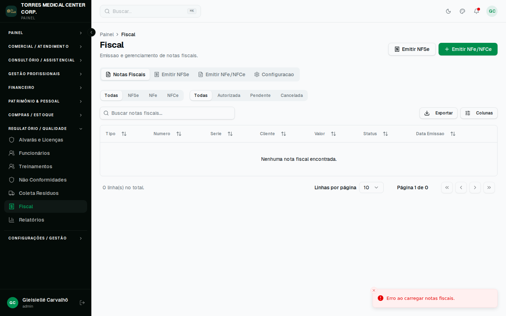

## Campos

| Nome | Rótulo | Tipo | Obrigatório | Valores/opções |
|---|---|---|---|---|
| — | Buscar notas fiscais... | text | não indicado | — |
| — | — | combobox | não indicado | — |

## Botões e ações

- Buscar... ⌘K
- Toggle theme
- Customize theme
- Notifications
- GC
- Emitir NFSe
- Emitir NFe/NFCe
- Notas Fiscais
- Emitir NFSe
- Emitir NFe/NFCe
- Configuracao
- Todas
- NFSe
- NFe
- NFCe
- Autorizada
- Pendente
- Cancelada
- Exportar
- Colunas
- Tipo
- Numero
- Serie
- Cliente
- Valor
- Status
- Data Emissao
- 10
- Ir para primeira página _(desabilitado)_
- Ir para página anterior _(desabilitado)_
- Ir para próxima página _(desabilitado)_
- Ir para última página _(desabilitado)_
- Close toast

## Tabelas / grids

**Tabela 1** — 1 linha(s) visível(is)

- Colunas: Tipo · Numero · Serie · Cliente · Valor · Status · Data Emissao
- Colunas possivelmente ordenáveis: Tipo, Numero, Serie, Cliente, Valor, Status, Data Emissao

- Filtros/busca: Buscar notas fiscais...
- Paginação: Página 1 de 0

## Abas

- Notas Fiscais _(ativa)_
- Emitir NFSe
- Emitir NFe/NFCe
- Configuracao

## Modais

_Nenhum modal aberto na carga da tela. Modais disparados por botões não foram abertos (regra somente-leitura)._

## Links para outras telas

- Painel → `/`

## Mensagens e validações visíveis

- Erro ao carregar notas fiscais.

<!-- estados -->
## Estados capturados (interações de visualização)

_Capturados em 15/10/2026 clicando só em itens de visualização do checklist da issue. Nenhum formulário foi preenchido e toda gravação foi bloqueada._

### Aba: Notas Fiscais

### Aba: Emitir NFSe

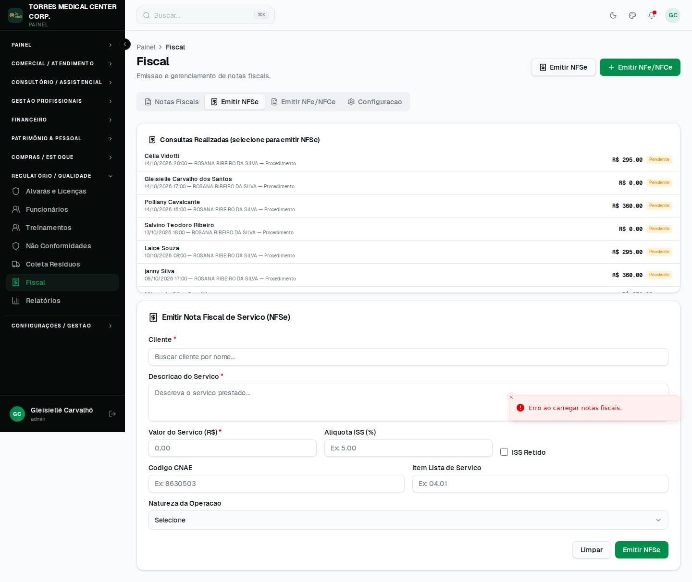

### Aba: Emitir NFe/NFCe

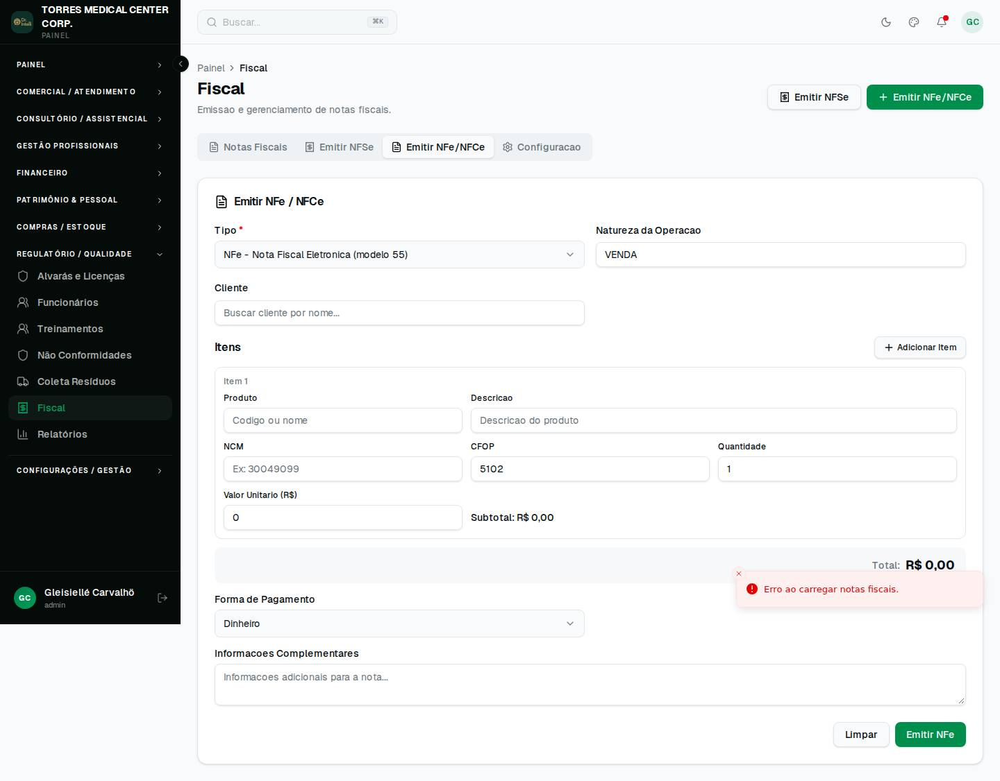

### Aba: Configuracao

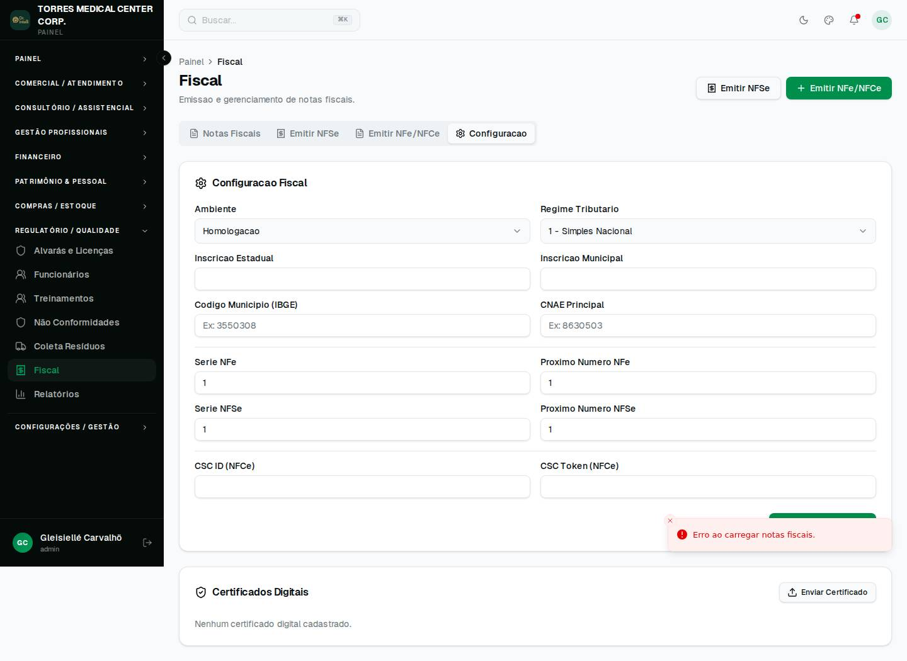

### Todas

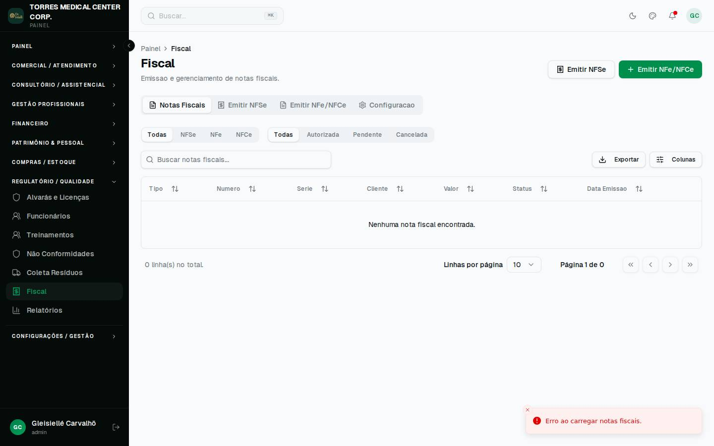

### NFe

### NFCe

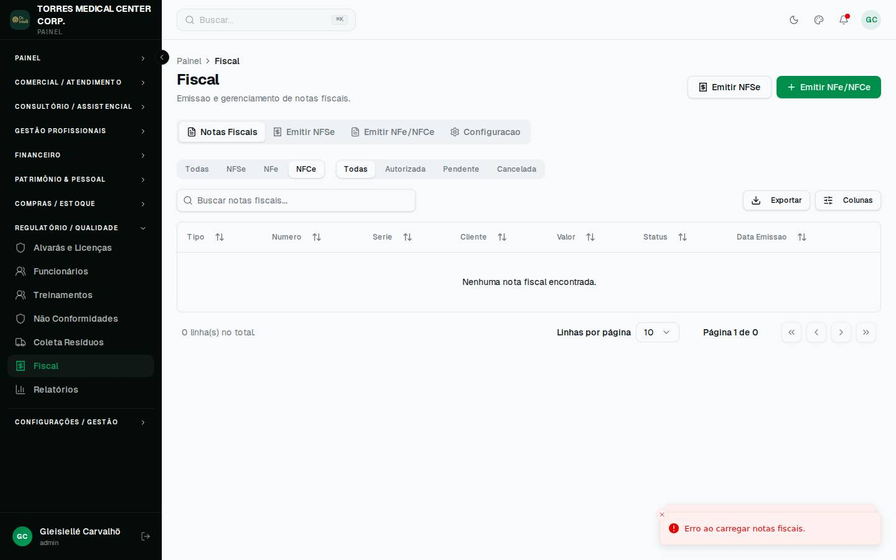

### Autorizada

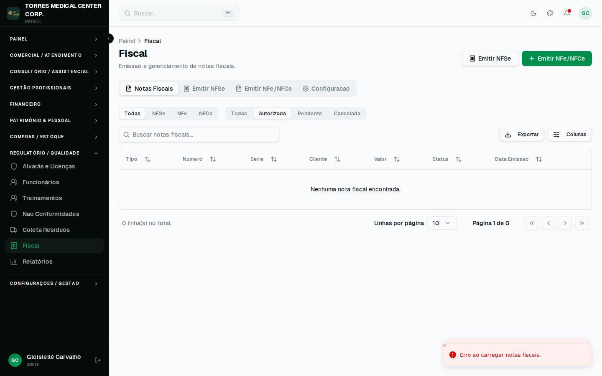

### Pendente

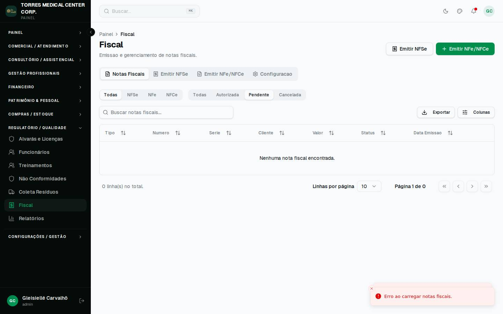

### Cancelada

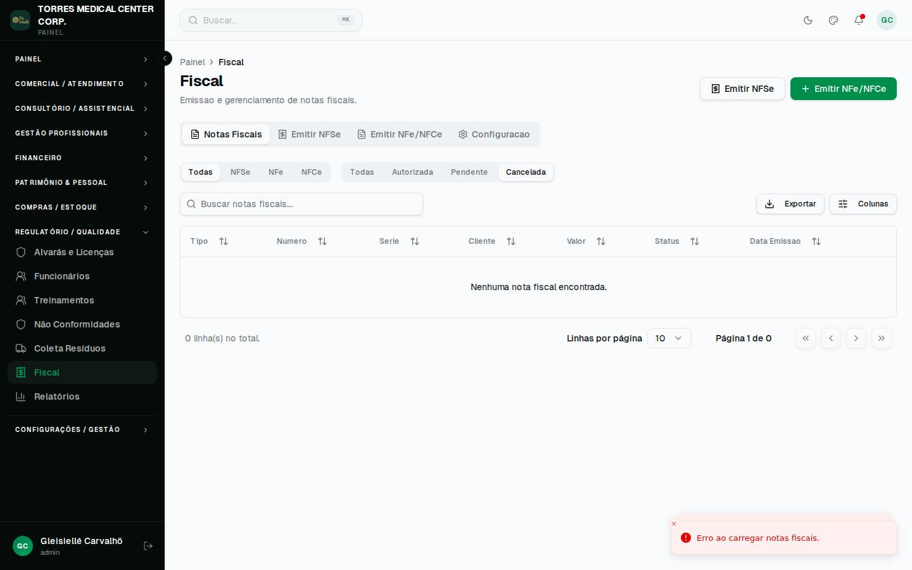

### Colunas

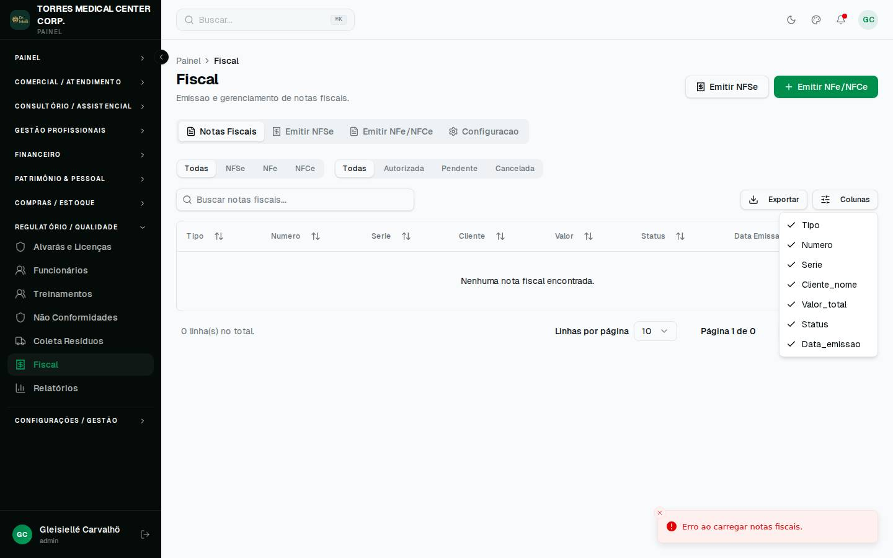

- Itens do menu/lista: Tipo · Numero · Serie · Cliente_nome · Valor_total · Status · Data_emissao

### Ordenação por coluna — 1 print de exemplo (colunas: Tipo, Numero, Serie, Cliente, Valor, Status, Data Emissao)

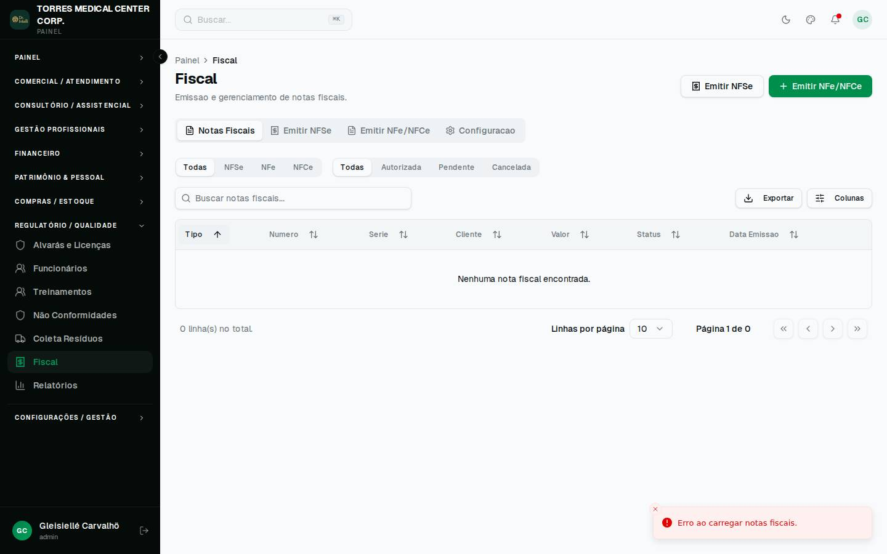

### Paginação — 1 print da página 2

- lista com uma página só (botão de próxima página desabilitado), sem print

<!-- /estados -->
