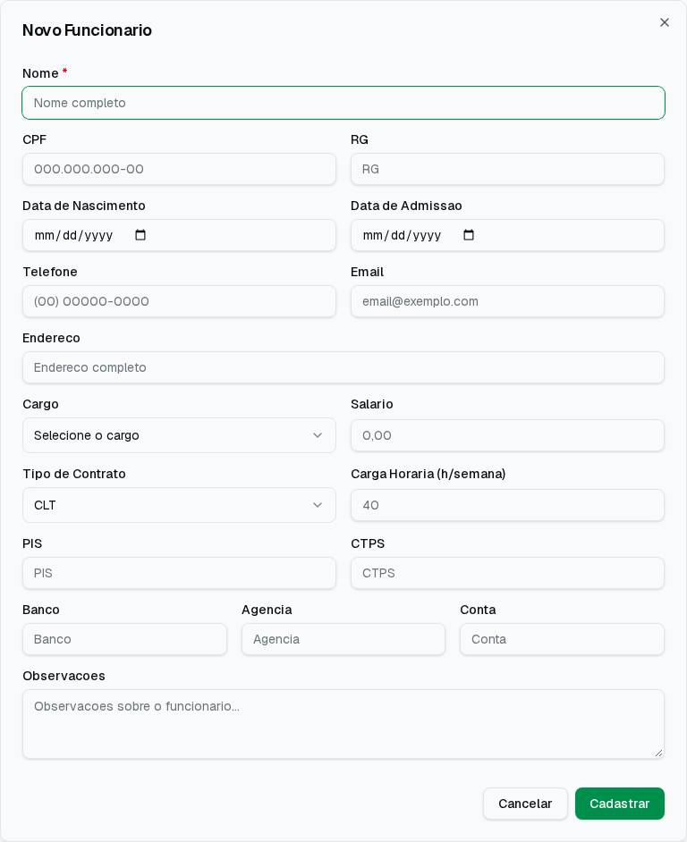
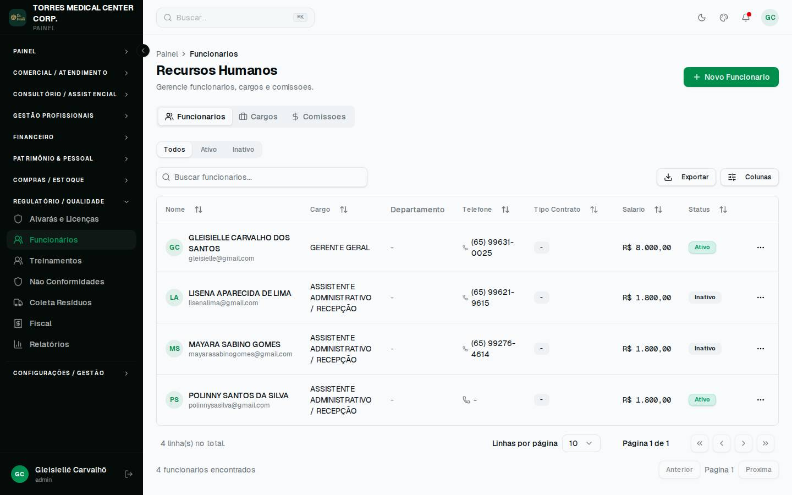
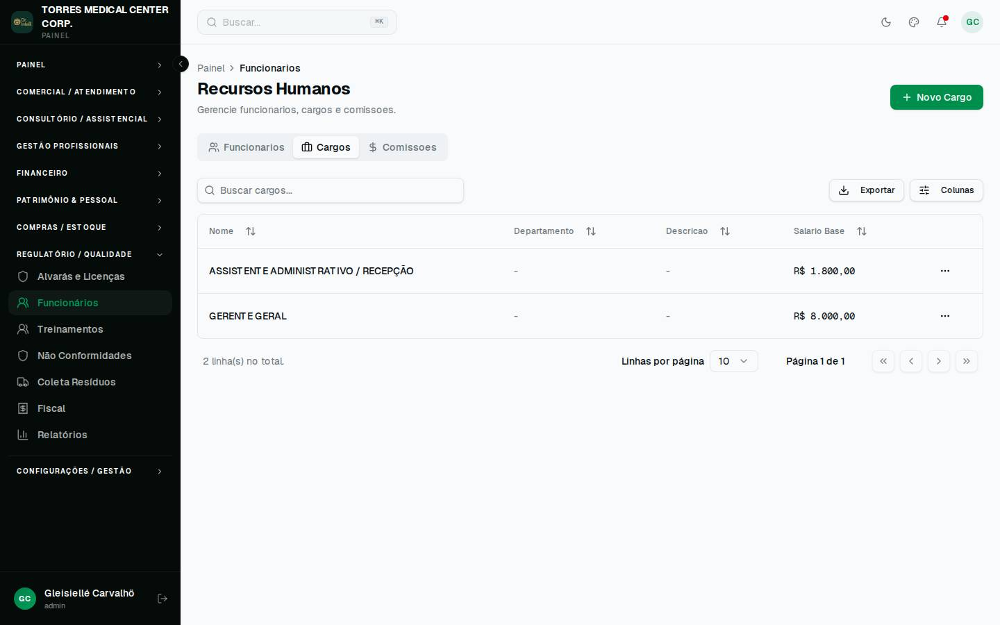
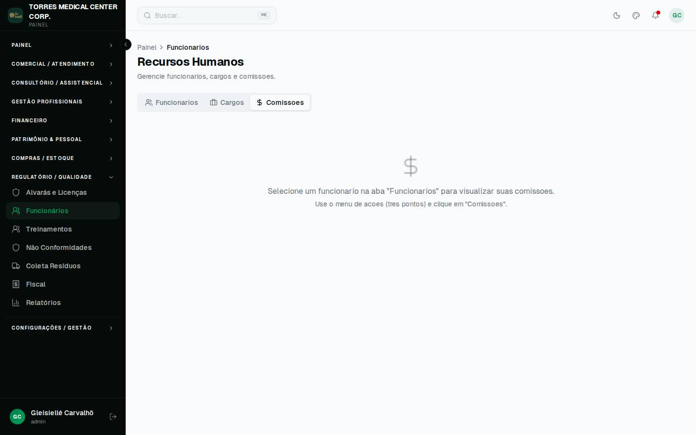
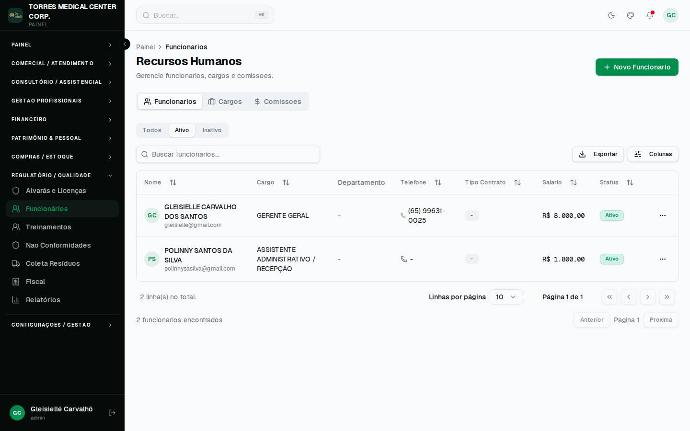
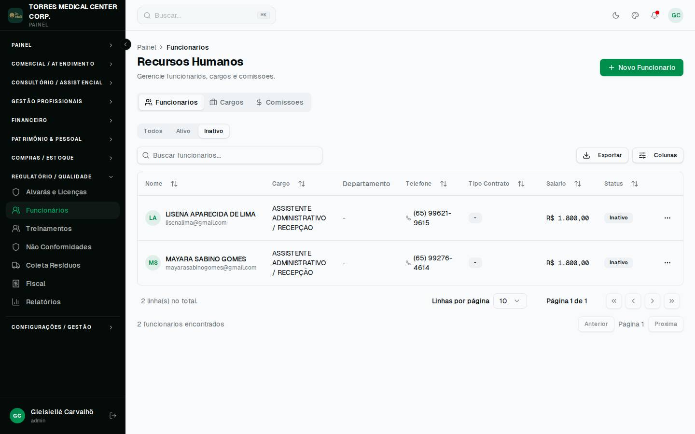
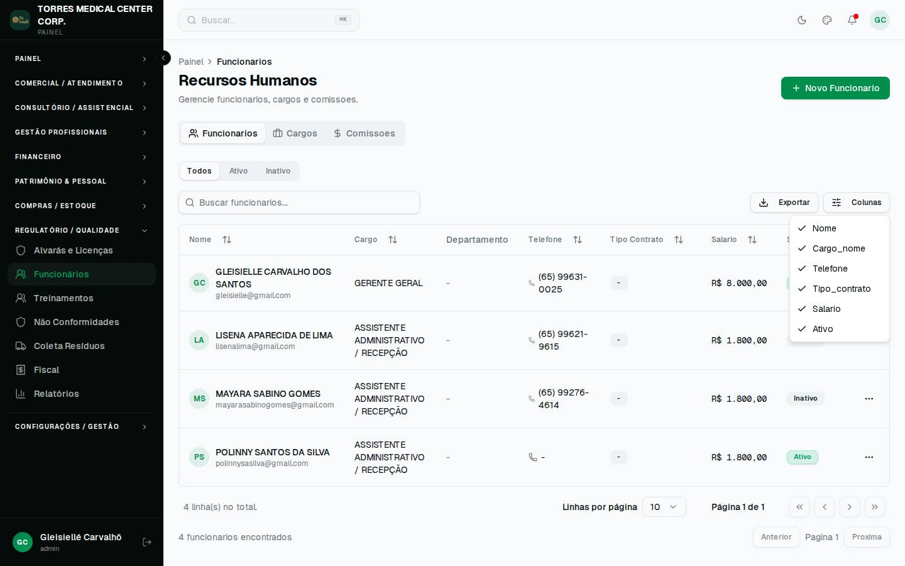
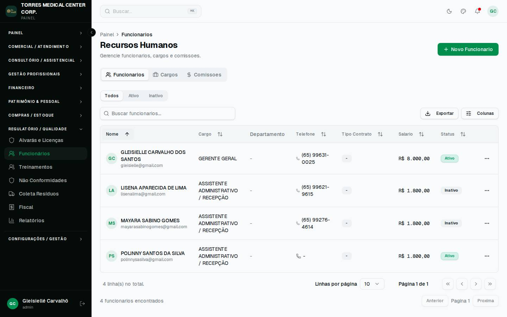
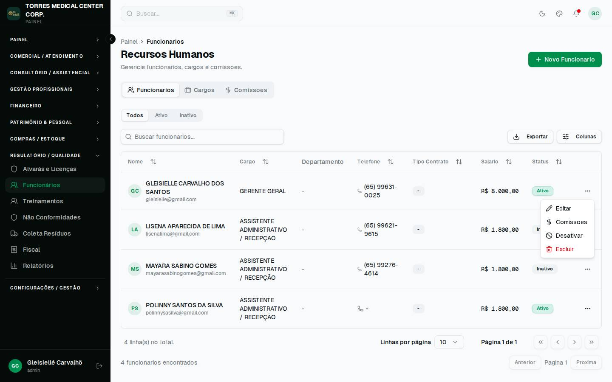

# Funcionários

- **Módulo:** REGULATÓRIO / QUALIDADE
- **Tela:** Funcionários
- **URL:** `/funcionarios`
- **Título na página:** Recursos Humanos

## Objetivo (inferido)

Tela "Funcionários" do módulo REGULATÓRIO / QUALIDADE. Apresenta listagem em tabela com colunas Nome, Cargo, Departamento, Telefone, Tipo Contrato, Salario. Possui 2 campo(s) de entrada/filtro. Organizada em abas (Funcionarios, Cargos, Comissoes). Texto de apoio: "Painel Funcionarios Recursos Humanos Gerencie funcionarios, cargos e comissoes. Novo Funcionario Funcionarios Cargos Comissoes Todos Ativo Inativo Exportar Colunas Nome Cargo Departamento Telefone Tip…"

## Screenshot

## Campos

| Nome | Rótulo | Tipo | Obrigatório | Valores/opções |
|---|---|---|---|---|
| — | Buscar funcionarios... | text | não indicado | — |
| — | — | combobox | não indicado | — |

## Botões e ações

- Buscar... ⌘K
- Toggle theme
- Customize theme
- Notifications
- GC
- Novo Funcionario
- Funcionarios
- Cargos
- Comissoes
- Todos
- Ativo
- Inativo
- Exportar
- Colunas
- Nome
- Cargo
- Telefone
- Tipo Contrato
- Salario
- Status
- Acoes
- 10
- Ir para primeira página _(desabilitado)_
- Ir para página anterior _(desabilitado)_
- Ir para próxima página _(desabilitado)_
- Ir para última página _(desabilitado)_
- Anterior _(desabilitado)_
- Proxima _(desabilitado)_

## Tabelas / grids

**Tabela 1** — 4 linha(s) visível(is)

- Colunas: Nome · Cargo · Departamento · Telefone · Tipo Contrato · Salario · Status
- Colunas possivelmente ordenáveis: Nome, Cargo, Telefone, Tipo Contrato, Salario, Status

- Filtros/busca: Buscar funcionarios...
- Paginação: Página 1 de 1

## Abas

- Funcionarios _(ativa)_
- Cargos
- Comissoes

## Modais

_Nenhum modal aberto na carga da tela. Modais disparados por botões não foram abertos (regra somente-leitura)._

## Links para outras telas

- Painel → `/`

## Mensagens e validações visíveis

_Nenhuma mensagem visível._

<!-- estados -->
## Estados capturados (interações de visualização)

_Capturados em 15/10/2026 clicando só em itens de visualização do checklist da issue. Nenhum formulário foi preenchido e toda gravação foi bloqueada._

### Novo Funcionario

- Abre modal **Novo Funcionario**

| Campo | Tipo | Obrigatório | Opções |
|---|---|---|---|
| Nome * | text | sim | — |
| CPF | text | não indicado | — |
| RG | text | não indicado | — |
| Data de Nascimento | date | não indicado | — |
| Data de Admissao | date | não indicado | — |
| Telefone | text | não indicado | — |
| Email | email | não indicado | — |
| Endereco | text | não indicado | — |
| Cargo | combobox | não indicado | — |
| Salario | number | não indicado | — |
| Tipo de Contrato | combobox | não indicado | — |
| Carga Horaria (h/semana) | number | não indicado | — |
| PIS | text | não indicado | — |
| CTPS | text | não indicado | — |
| Banco | text | não indicado | — |
| Agencia | text | não indicado | — |
| Conta | text | não indicado | — |
| Observacoes | textarea | não indicado | — |

- Botões do modal: Selecione o cargo · CLT · Cancelar · Cadastrar · Close

### Aba: Funcionarios

### Aba: Cargos

### Aba: Comissoes

### Todos

### Ativo

### Inativo

### Colunas

- Itens do menu/lista: Nome · Cargo_nome · Telefone · Tipo_contrato · Salario · Ativo

### Ordenação por coluna — 1 print de exemplo (colunas: Nome, Cargo, Telefone, Tipo Contrato, Salario, Status)

### Menu de ações (⋯) (na linha da tabela)

- Itens do menu/lista: Editar · Comissoes · Desativar · Excluir

### Paginação — 1 print da página 2

- lista com uma página só (botão de próxima página desabilitado), sem print

<!-- /estados -->
