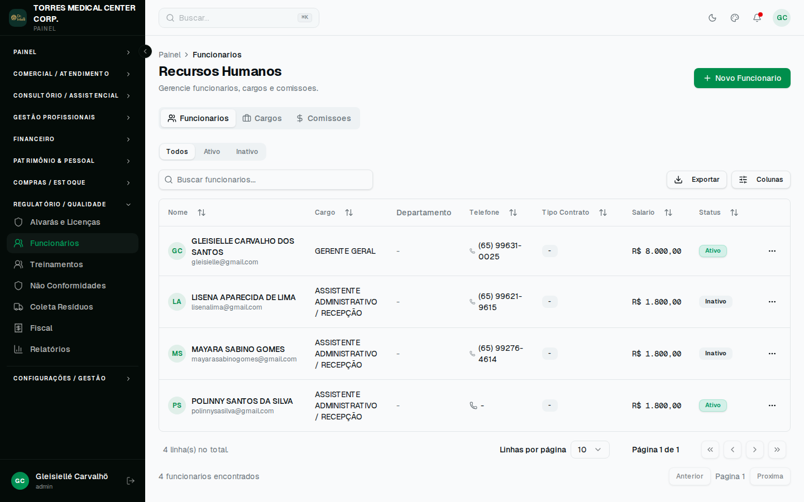

# Funcionários

- **Módulo:** REGULATÓRIO / QUALIDADE
- **Tela:** Funcionários
- **URL:** `/funcionarios`
- **Título na página:** Recursos Humanos

## Objetivo (inferido)

Tela "Funcionários" do módulo REGULATÓRIO / QUALIDADE. Apresenta listagem em tabela com colunas Nome, Cargo, Departamento, Telefone, Tipo Contrato, Salario. Possui 2 campo(s) de entrada/filtro. Organizada em abas (Funcionarios, Cargos, Comissoes). Texto de apoio: "Painel Funcionarios Recursos Humanos Gerencie funcionarios, cargos e comissoes. Novo Funcionario Funcionarios Cargos Comissoes Todos Ativo Inativo Exportar Colunas Nome Cargo Departamento Telefone Tip…"

## Screenshot

## Campos

| Nome | Rótulo | Tipo | Obrigatório | Valores/opções |
|---|---|---|---|---|
| — | Buscar funcionarios... | text | não indicado | — |
| — | — | combobox | não indicado | — |

## Botões e ações

- Buscar... ⌘K
- Toggle theme
- Customize theme
- Notifications
- GC
- Novo Funcionario
- Funcionarios
- Cargos
- Comissoes
- Todos
- Ativo
- Inativo
- Exportar
- Colunas
- Nome
- Cargo
- Telefone
- Tipo Contrato
- Salario
- Status
- Acoes
- 10
- Ir para primeira página _(desabilitado)_
- Ir para página anterior _(desabilitado)_
- Ir para próxima página _(desabilitado)_
- Ir para última página _(desabilitado)_
- Anterior _(desabilitado)_
- Proxima _(desabilitado)_

## Tabelas / grids

**Tabela 1** — 4 linha(s) visível(is)

- Colunas: Nome · Cargo · Departamento · Telefone · Tipo Contrato · Salario · Status
- Colunas possivelmente ordenáveis: Nome, Cargo, Telefone, Tipo Contrato, Salario, Status

- Filtros/busca: Buscar funcionarios...
- Paginação: Página 1 de 1

## Abas

- Funcionarios _(ativa)_
- Cargos
- Comissoes

## Modais

_Nenhum modal aberto na carga da tela. Modais disparados por botões não foram abertos (regra somente-leitura)._

## Links para outras telas

- Painel → `/`

## Mensagens e validações visíveis

_Nenhuma mensagem visível._
