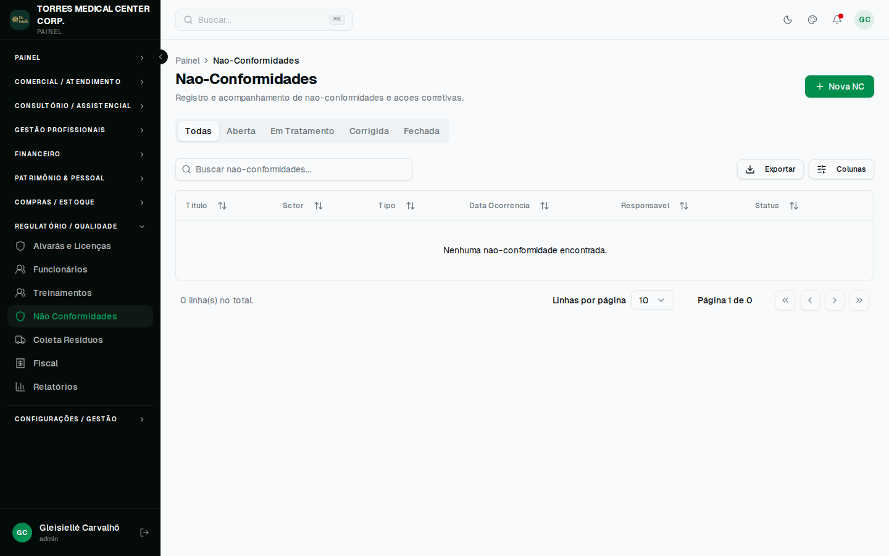
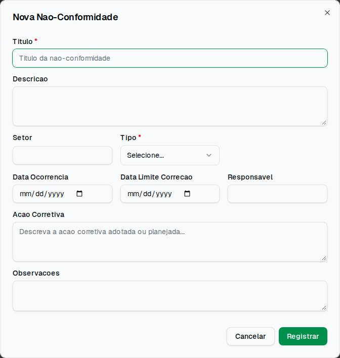
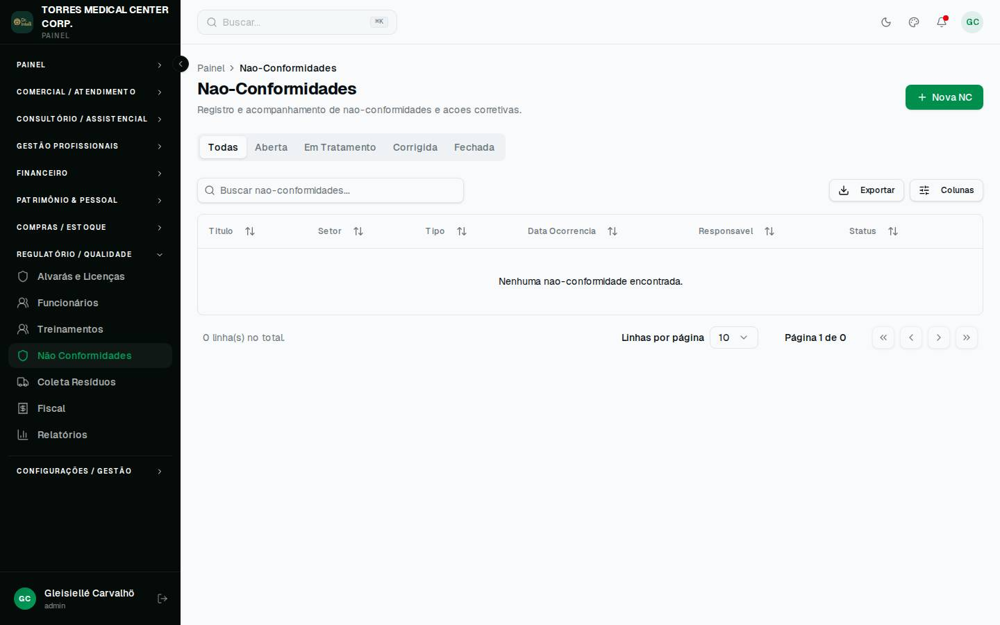
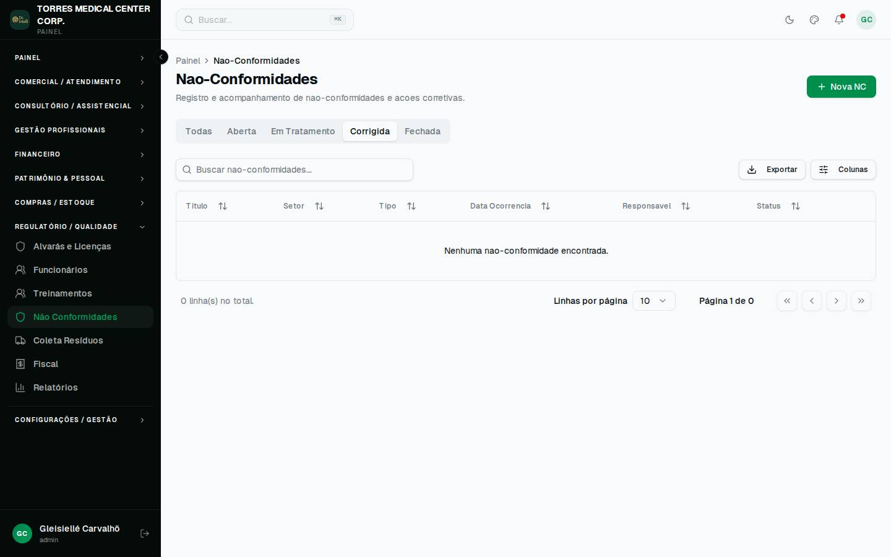
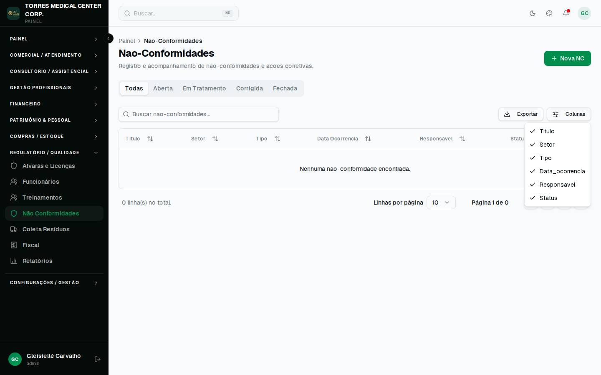
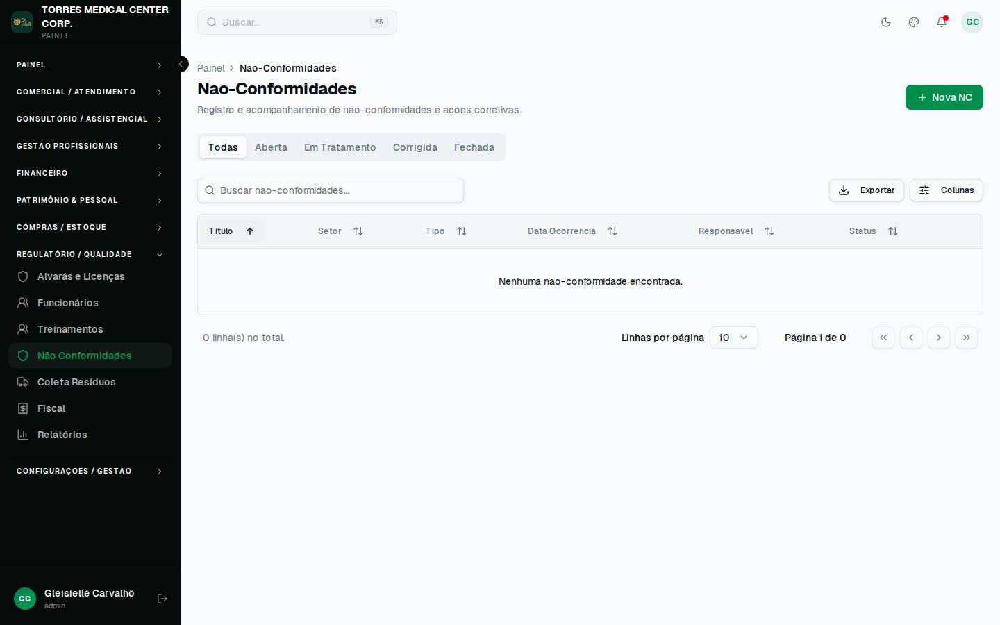

# Não Conformidades

- **Módulo:** REGULATÓRIO / QUALIDADE
- **Tela:** Não Conformidades
- **URL:** `/nao-conformidades`
- **Título na página:** Nao-Conformidades

## Objetivo (inferido)

Tela "Não Conformidades" do módulo REGULATÓRIO / QUALIDADE. Apresenta listagem em tabela com colunas Titulo, Setor, Tipo, Data Ocorrencia, Responsavel, Status. Possui 2 campo(s) de entrada/filtro. Organizada em abas (Todas, Aberta, Em Tratamento, Corrigida, Fechada). Texto de apoio: "Painel Nao-Conformidades Nao-Conformidades Registro e acompanhamento de nao-conformidades e acoes corretivas. Nova NC Todas Aberta Em Tratamento Corrigida Fechada Exportar Colunas Titulo Setor Tipo Da…"

## Screenshot

## Campos

| Nome | Rótulo | Tipo | Obrigatório | Valores/opções |
|---|---|---|---|---|
| — | Buscar nao-conformidades... | text | não indicado | — |
| — | — | combobox | não indicado | — |

## Botões e ações

- Buscar... ⌘K
- Toggle theme
- Customize theme
- Notifications
- GC
- Nova NC
- Todas
- Aberta
- Em Tratamento
- Corrigida
- Fechada
- Exportar
- Colunas
- Titulo
- Setor
- Tipo
- Data Ocorrencia
- Responsavel
- Status
- 10
- Ir para primeira página _(desabilitado)_
- Ir para página anterior _(desabilitado)_
- Ir para próxima página _(desabilitado)_
- Ir para última página _(desabilitado)_

## Tabelas / grids

**Tabela 1** — 1 linha(s) visível(is)

- Colunas: Titulo · Setor · Tipo · Data Ocorrencia · Responsavel · Status
- Colunas possivelmente ordenáveis: Titulo, Setor, Tipo, Data Ocorrencia, Responsavel, Status

- Filtros/busca: Buscar nao-conformidades...
- Paginação: Página 1 de 0

## Abas

- Todas _(ativa)_
- Aberta
- Em Tratamento
- Corrigida
- Fechada

## Modais

_Nenhum modal aberto na carga da tela. Modais disparados por botões não foram abertos (regra somente-leitura)._

## Links para outras telas

- Painel → `/`

## Mensagens e validações visíveis

_Nenhuma mensagem visível._

<!-- estados -->
## Estados capturados (interações de visualização)

_Capturados em 15/10/2026 clicando só em itens de visualização do checklist da issue. Nenhum formulário foi preenchido e toda gravação foi bloqueada._

### Nova NC

- Abre modal **Nova Nao-Conformidade**

| Campo | Tipo | Obrigatório | Opções |
|---|---|---|---|
| Titulo * | text | sim | — |
| Descricao | textarea | não indicado | — |
| Setor | text | não indicado | — |
| Tipo * | combobox | sim | — |
| Data Ocorrencia | date | não indicado | — |
| Data Limite Correcao | date | não indicado | — |
| Responsavel | text | não indicado | — |
| Acao Corretiva | textarea | não indicado | — |
| Observacoes | textarea | não indicado | — |

- Botões do modal: Selecione... · Cancelar · Registrar · Close

### Aba: Todas

### Aba: Aberta

### Aba: Em Tratamento

### Aba: Corrigida

### Aba: Fechada

### Colunas

- Itens do menu/lista: Titulo · Setor · Tipo · Data_ocorrencia · Responsavel · Status

### Ordenação por coluna — 1 print de exemplo (colunas: Titulo, Setor, Tipo, Data Ocorrencia, Responsavel, Status)

### Paginação — 1 print da página 2

- lista com uma página só (botão de próxima página desabilitado), sem print

<!-- /estados -->
