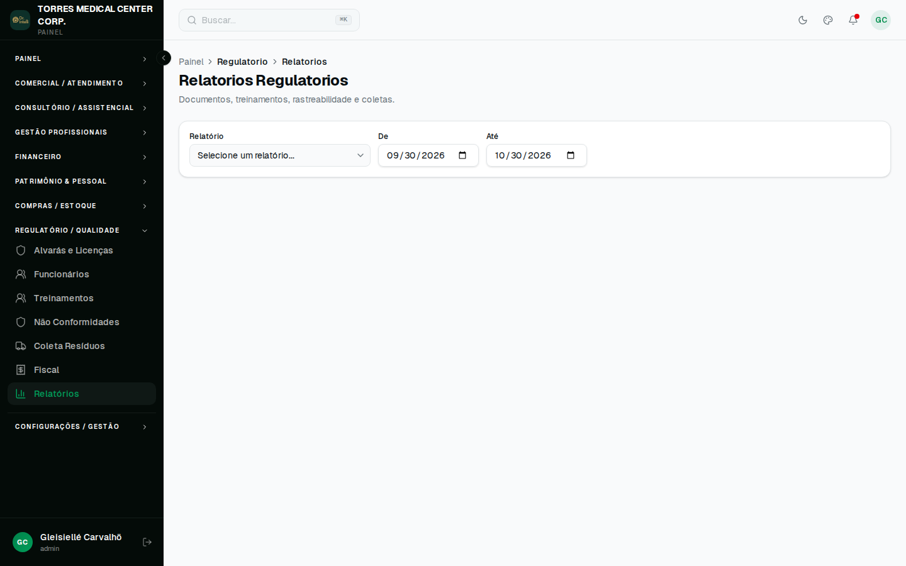

# Relatórios

- **Módulo:** REGULATÓRIO / QUALIDADE
- **Tela:** Relatórios
- **URL:** `/regulatorio/relatorios`
- **Título na página:** Relatorios Regulatorios

## Objetivo (inferido)

Tela "Relatórios" do módulo REGULATÓRIO / QUALIDADE. Possui 3 campo(s) de entrada/filtro. Texto de apoio: "Painel Regulatorio Relatorios Relatorios Regulatorios Documentos, treinamentos, rastreabilidade e coletas. Relatório Selecione um relatório... REG-01 — Documentos a Vencer REG-02 — Treinamentos Penden…"

## Screenshot

## Campos

| Nome | Rótulo | Tipo | Obrigatório | Valores/opções |
|---|---|---|---|---|
| — | — | select | não indicado | Selecione um relatório..., REG-01 — Documentos a Vencer, REG-02 — Treinamentos Pendentes, REG-03 — Rastreabilidade de Lote, REG-04 — Coletas de Residuo |
| — | De | date | não indicado | — |
| — | Até | date | não indicado | — |

## Botões e ações

- Buscar... ⌘K
- Toggle theme
- Customize theme
- Notifications
- GC

## Tabelas / grids

_Nenhuma tabela encontrada._

- Filtros/busca: não identificado
- Paginação: não identificada

## Abas

_Nenhuma aba._

## Modais

_Nenhum modal aberto na carga da tela. Modais disparados por botões não foram abertos (regra somente-leitura)._

## Links para outras telas

- Painel → `/`

## Mensagens e validações visíveis

_Nenhuma mensagem visível._
