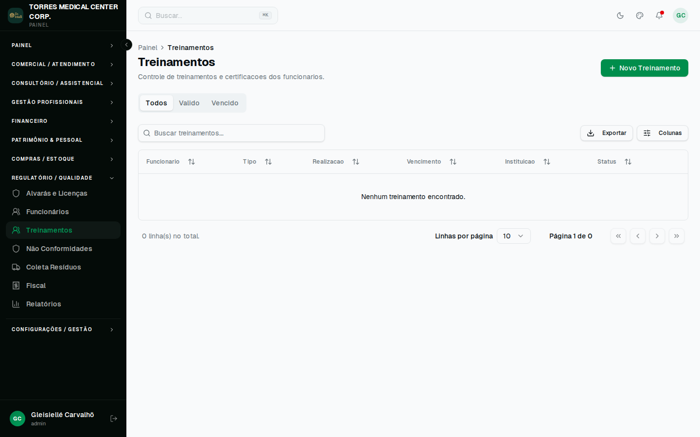
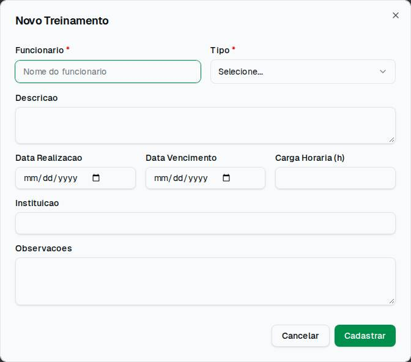
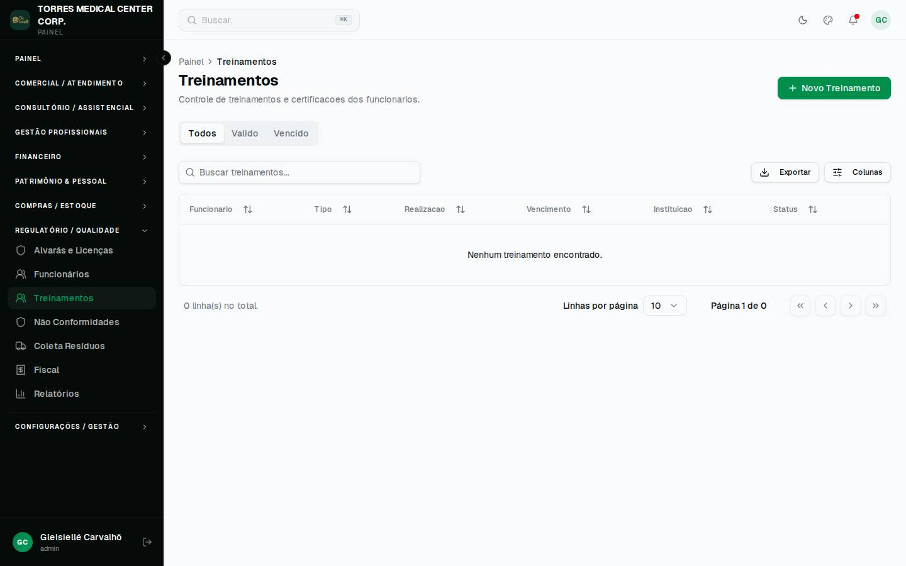
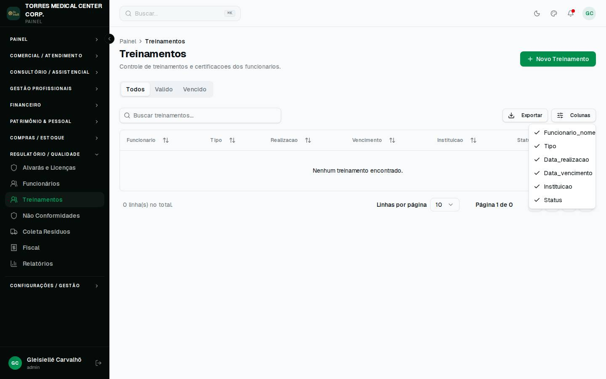
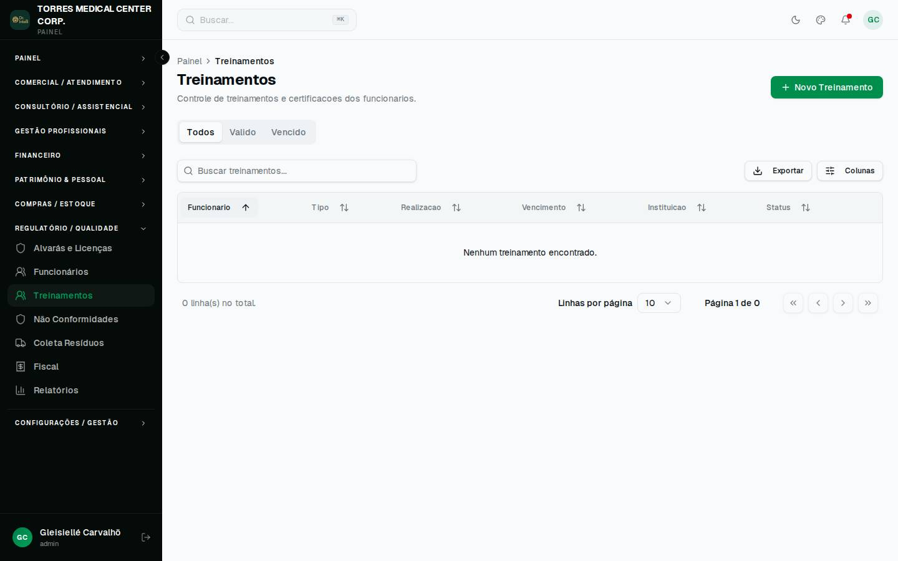

# Treinamentos

- **Módulo:** REGULATÓRIO / QUALIDADE
- **Tela:** Treinamentos
- **URL:** `/treinamentos`
- **Título na página:** Treinamentos

## Objetivo (inferido)

Tela "Treinamentos" do módulo REGULATÓRIO / QUALIDADE. Apresenta listagem em tabela com colunas Funcionario, Tipo, Realizacao, Vencimento, Instituicao, Status. Possui 2 campo(s) de entrada/filtro. Organizada em abas (Todos, Valido, Vencido). Texto de apoio: "Painel Treinamentos Treinamentos Controle de treinamentos e certificacoes dos funcionarios. Novo Treinamento Todos Valido Vencido Exportar Colunas Funcionario Tipo Realizacao Vencimento Instituicao St…"

## Screenshot

## Campos

| Nome | Rótulo | Tipo | Obrigatório | Valores/opções |
|---|---|---|---|---|
| — | Buscar treinamentos... | text | não indicado | — |
| — | — | combobox | não indicado | — |

## Botões e ações

- Buscar... ⌘K
- Toggle theme
- Customize theme
- Notifications
- GC
- Novo Treinamento
- Todos
- Valido
- Vencido
- Exportar
- Colunas
- Funcionario
- Tipo
- Realizacao
- Vencimento
- Instituicao
- Status
- 10
- Ir para primeira página _(desabilitado)_
- Ir para página anterior _(desabilitado)_
- Ir para próxima página _(desabilitado)_
- Ir para última página _(desabilitado)_

## Tabelas / grids

**Tabela 1** — 1 linha(s) visível(is)

- Colunas: Funcionario · Tipo · Realizacao · Vencimento · Instituicao · Status
- Colunas possivelmente ordenáveis: Funcionario, Tipo, Realizacao, Vencimento, Instituicao, Status

- Filtros/busca: Buscar treinamentos...
- Paginação: Página 1 de 0

## Abas

- Todos _(ativa)_
- Valido
- Vencido

## Modais

_Nenhum modal aberto na carga da tela. Modais disparados por botões não foram abertos (regra somente-leitura)._

## Links para outras telas

- Painel → `/`

## Mensagens e validações visíveis

_Nenhuma mensagem visível._

<!-- estados -->
## Estados capturados (interações de visualização)

_Capturados em 15/10/2026 clicando só em itens de visualização do checklist da issue. Nenhum formulário foi preenchido e toda gravação foi bloqueada._

### Novo Treinamento

- Abre modal **Novo Treinamento**

| Campo | Tipo | Obrigatório | Opções |
|---|---|---|---|
| Funcionario * | text | sim | — |
| Tipo * | combobox | sim | — |
| Descricao | textarea | não indicado | — |
| Data Realizacao | date | não indicado | — |
| Data Vencimento | date | não indicado | — |
| Carga Horaria (h) | number | não indicado | — |
| Instituicao | text | não indicado | — |
| Observacoes | textarea | não indicado | — |

- Botões do modal: Selecione... · Cancelar · Cadastrar · Close

### Aba: Todos

### Aba: Valido

### Aba: Vencido

### Colunas

- Itens do menu/lista: Funcionario_nome · Tipo · Data_realizacao · Data_vencimento · Instituicao · Status

### Ordenação por coluna — 1 print de exemplo (colunas: Funcionario, Tipo, Realizacao, Vencimento, Instituicao, Status)

### Paginação — 1 print da página 2

- lista com uma página só (botão de próxima página desabilitado), sem print

<!-- /estados -->
